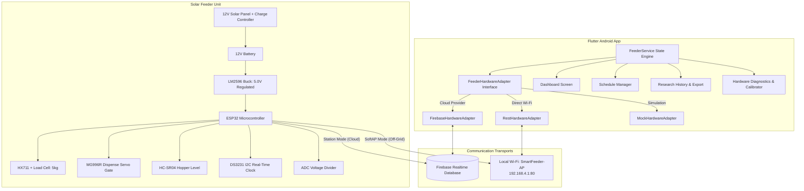

# Smart Mobile-Based Solar-Powered Chicken Feeding System

[](app/test/widget_test.dart)
[](firmware/platformio.ini)
[](docs/FIREBASE_SETUP_GUIDE.md)
[](docs/HARDWARE_INTEGRATION_SPECIFICATION.md)
[](LICENSE)

An intelligent, solar-powered agricultural automation system that provides automated poultry feed dispensing based on precision weight measurements, real-time hopper level sensing, battery solar telemetry, and dual-mode mobile connectivity (Firebase Cloud + Direct Wi-Fi SoftAP).

---

## Table of Contents

- [System Architecture](#system-architecture)
- [Key Features](#key-features)
- [Repository Structure](#repository-structure)
- [Hardware & Electrical Pinouts](#hardware--electrical-pinouts)
- [Direct Local REST API (SoftAP)](#direct-local-rest-api-softap)
- [Firebase Realtime Database Schema](#firebase-realtime-database-schema)
- [Getting Started](#getting-started)
  - [Prerequisites](#prerequisites)
  - [1. Firmware Setup (ESP32)](#1-firmware-setup-esp32)
  - [2. Mobile App Setup (Flutter)](#2-mobile-app-setup-flutter)
  - [3. Running Bench Diagnostics](#3-running-bench-diagnostics)
- [Automated Test Suite](#automated-test-suite)
- [Documentation Index](#documentation-index)
- [Security & Contribution Rules](#security--contribution-rules)

---

## System Architecture

The system utilizes a **Dual-Mode Hybrid Transport Architecture** enabling uninterrupted operation in both remote internet-connected farms and completely off-grid rural environments:



### Communication Modes

1. **Cloud Mode (Firebase RTDB):**
   - Connects to the farm router via Station Wi-Fi.
   - Pushes sub-second telemetry (`/telemetry`) and executes asynchronous remote commands (`/commands/dispense`).
   - Synchronizes feeding routines (`/schedules`) and historical logs (`/logs`) accessible globally from anywhere.
2. **Direct Local Mode (SoftAP & REST):**
   - The ESP32 broadcasts an autonomous Wi-Fi network: **`SmartFeeder-AP`** (`192.168.4.1:80`).
   - Allows zero-latency local feeding, tare calibration, emergency gate closure, and diagnostics without internet or router infrastructure.

---

## Key Features

- **Precision Gravimetric Dispensing:** Closed-loop weight feedback via an HX711 24-bit ADC amplifier and 5kg load cell. Stops the dispenser gate automatically once the target weight (grams) is reached.
- **Hopper Ultrasonic Level Monitoring:** HC-SR04 sensor measures feed height in the hopper and computes percentage and supply days remaining.
- **Off-Grid Autonomous Scheduling:** Synchronizes scheduled feeding times to an onboard DS3231 I2C Real-Time Clock, allowing feedings to run on time even during power or internet outages.
- **Solar Battery & Health Telemetry:** 12V lead-acid / LiFePO4 battery monitoring through a resistive voltage divider with low-battery warnings.
- **Dual-Mode Hardware Adapter:** Decoupled Flutter architecture allowing instantaneous toggle between Firebase Cloud, Local SoftAP HTTP, and Mock Simulator.
- **Research Analytics & Empirical Export:** Built-in calculation of target vs. actual dispensing accuracy (%), empirical variance, and one-tap export to **Excel Workbook (.xls)** or **CSV** for academic and Chapter IV thesis analysis.
- **Built-In Diagnostics & Calibration Wizard:** 2-point load cell calibration (zero tare and 500g reference weight calculation) and manual servo angle sweep testing (0°, 45°, 90°) directly from the app.

---

## Repository Structure

```text
AutomaticDispensing/
├── firmware/                       # ESP32 Embedded C++ Firmware
│   ├── src/
│   │   ├── main.cpp                # Core application, FreeRTOS tasks, HTTP server & Firebase loop
│   │   ├── config.h                # Hardware pin definitions & calibration constants
│   │   ├── load_cell.cpp/.h        # HX711 driver, tare, and continuous sampling
│   │   ├── servo_controller.cpp/.h # PWM servo dispense gate control & jam protection
│   │   ├── ultrasonic.cpp/.h       # HC-SR04 distance filter & hopper % mapping
│   │   ├── rtc_manager.cpp/.h      # DS3231 RTC driver & offline alarm evaluation
│   │   └── battery_monitor.cpp/.h  # ADC battery voltage calculation & state-of-charge
│   ├── include/
│   │   └── secrets.example.h       # Wi-Fi SSID, password & Firebase credentials template
│   └── platformio.ini              # PlatformIO build configurations & dependencies
│
├── app/                            # Flutter Android Mobile Application
│   ├── lib/
│   │   ├── main.dart               # App entry point, theme & route configuration
│   │   ├── models/                 # Telemetry, FeedingSchedule, FeedingLog data models
│   │   ├── services/
│   │   │   ├── feeder_service.dart # State manager, stream subscriptions, optimistic caching
│   │   │   └── hardware/           # Hardware transport abstraction layer
│   │   │       ├── feeder_hardware_adapter.dart  # Abstract interface
│   │   │       ├── firebase_hardware_adapter.dart# Firebase RTDB & REST client
│   │   │       ├── rest_hardware_adapter.dart    # Direct SoftAP HTTP REST client
│   │   │       └── mock_hardware_adapter.dart    # Offline bench mock simulator
│   │   └── screens/
│   │       ├── dashboard_screen.dart   # Live gauges, solar telemetry & quick dispense
│   │       ├── schedule_screen.dart    # Routine scheduler with undo support
│   │       ├── history_screen.dart     # Empirical data table & Excel/CSV export
│   │       └── diagnostics_screen.dart # 2-point calibration & servo test sweep
│   └── test/
│       └── widget_test.dart        # 13 automated unit & socket loopback integration tests
│
├── docs/                           # Technical Specifications & Research Guides
│   ├── AUDIT_REPORT.md             # Full-Stack & Firebase Communication Audit
│   ├── BENCH_TESTING_GUIDE.md      # Bench testing, LM2596 tuning & wiring checklist
│   ├── FIREBASE_SETUP_GUIDE.md     # Firebase Realtime Database setup & security rules
│   ├── HARDWARE_INTEGRATION_SPECIFICATION.md # Complete electrical & pinout matrix
│   ├── SYSTEM_FLOWCHART.md         # Comprehensive system architecture & dataflow flowchart
│   └── methodology_analysis.md     # Theoretical framework & research methodology
│
├── data.json                       # Seed schema template for Firebase Realtime Database
├── AGENTS.md                       # Project coding rules, hygiene & commit constraints
└── README.md                       # Project documentation
```

---

## Hardware & Electrical Pinouts

### ESP32-WROOM-32 Pin Assignment

| Peripheral Component | Module Signal | ESP32 GPIO | Operating Voltage | Notes |
|:---|:---|:---|:---|:---|
| **HX711 Load Cell Amp** | Data Out (DOUT) | `GPIO 16` | 3.3V or 5.0V | 24-bit ADC; shielded wiring recommended |
| | Serial Clock (SCK) | `GPIO 4` | 3.3V or 5.0V | Clock line driven by ESP32 |
| **MG996R Servo Gate** | PWM Signal | `GPIO 18` | 5.0V (High Current) | Power from LM2596 buck; NOT from ESP32 pin! |
| **HC-SR04 Ultrasonic** | Trigger (TRIG) | `GPIO 5` | 5.0V | 10µs trigger pulse |
| | Echo (ECHO) | `GPIO 17` | 3.3V (Divided) | Use 1kΩ / 2kΩ divider to protect 3.3V GPIO |
| **DS3231 RTC Module** | I2C SDA | `GPIO 21` | 3.3V | Includes backup coin cell battery (CR2032) |
| | I2C SCL | `GPIO 22` | 3.3V | Fast-mode 400kHz I2C bus |
| **Battery Monitor** | Analog Sense | `GPIO 34` | ADC (0 – 3.3V) | Connect through 100kΩ / 20kΩ divider from 12V battery |
| **System Status LED** | Anode | `GPIO 2` | 3.3V | Onboard indicator (Wi-Fi / Dispense status) |

> [!CAUTION]
> ### Critical Power Supply Requirement: LM2596 Buck Tuning
> The MG996R servo motor draws up to **2.5A peak stall current**. 
> - **DO NOT power the servo from the ESP32 5V/VIN or 3.3V pins** — this will cause immediate brownouts and ESP32 core resets.
> - **Tune the LM2596 DC-DC buck converter to exactly 5.0V DC with a digital multimeter BEFORE connecting the ESP32 or servo.**
> - Connect all GND pins together to form a common ground reference plane between the solar battery, buck converter, ESP32, and servo.

---

## Direct Local REST API (SoftAP)

When connected to the **`SmartFeeder-AP`** Wi-Fi network, the ESP32 listens on **`http://192.168.4.1:80`**:

| Method | Endpoint | Request Body | Response Payload / Description |
|:---|:---|:---|:---|
| `GET` | `/api/telemetry` | None | Returns JSON object with live weight, hopper level, battery voltage, and status. |
| `POST` | `/api/dispense` | `{"durationSeconds": 5, "targetGrams": 150.0}` | Opens the servo gate until target weight or duration timeout is reached. |
| `POST` | `/api/stop` | None | Emergency gate closure; closes servo to 0° immediately and resets state. |
| `POST` | `/api/tare` | None | Resets scale offset to zero with empty feeding tray. |
| `POST` | `/api/calibrate` | `{"targetGrams": 500.0}` | Calculates and saves calibration factor using placed reference weight. |
| `GET` | `/` | None | Embedded lightweight HTML control dashboard for web browsers. |

---

## Firebase Realtime Database Schema

```json
{
  "telemetry": {
    "feedLevelPercent": 85.0,
    "batteryVolts": 12.65,
    "batteryPercent": 92,
    "currentWeightGrams": 0.0,
    "status": "idle",
    "isSolarCharging": true,
    "lastHeartbeat": 1729440000000
  },
  "commands": {
    "dispense": {
      "id": "cmd_1729425600000",
      "action": "DISPENSE",
      "durationSeconds": 5,
      "targetGrams": 180.0,
      "status": "pending"
    },
    "latest": {
      "id": "cmd_1729425600000",
      "action": "DISPENSE",
      "durationSeconds": 5,
      "targetGrams": 180.0,
      "status": "dispatched"
    }
  },
  "schedules": {
    "sch_morning": {
      "id": "sch_morning",
      "label": "Morning Feeding",
      "hour": 6,
      "minute": 30,
      "targetGrams": 180.0,
      "isEnabled": true
    }
  },
  "logs": {
    "log_sample_01": {
      "timestamp": 1729425600000,
      "targetGrams": 180.0,
      "actualGrams": 181.2,
      "durationSeconds": 11,
      "triggerType": "Schedule",
      "isSuccess": true,
      "batteryVolts": 12.65,
      "feedLevelPercent": 85.0
    }
  }
}
```

---

## Getting Started

### Prerequisites

- **ESP32 Firmware:** [PlatformIO Core (CLI)](https://platformio.org/) or VS Code PlatformIO extension.
- **Mobile App:** [Flutter SDK](https://flutter.dev/) (3.16+ recommended) with Android SDK and USB debugging enabled.

---

### 1. Firmware Setup (ESP32)

1. Navigate to the `firmware/` directory:
   ```powershell
   cd firmware
   ```
2. Create your private `secrets.h` from the template:
   ```powershell
   copy include\secrets.example.h include\secrets.h
   ```
3. Open `include/secrets.h` and provide your farm Wi-Fi credentials and Firebase database URL:
   ```cpp
   #define WIFI_SSID         "Your_Farm_WiFi"
   #define WIFI_PASSWORD     "Your_WiFi_Password"
   #define FIREBASE_HOST     "smart-chicken-feeder-33bec-default-rtdb.asia-southeast1.firebasedatabase.app"
   #define FIREBASE_AUTH     "YOUR_FIREBASE_DATABASE_SECRET_OR_TOKEN"
   ```
4. Build the firmware:
   ```powershell
   pio run
   ```
5. Connect your ESP32 via USB and upload:
   ```powershell
   pio run -t upload
   pio device monitor
   ```

---

### 2. Mobile App Setup (Flutter)

1. Navigate to the `app/` directory:
   ```powershell
   cd app
   ```
2. Fetch project dependencies:
   ```powershell
   flutter pub get
   ```
3. Run the automated test suite to verify all models and socket adapters:
   ```powershell
   flutter test --no-pub
   ```
4. Launch the application on a connected Android phone or emulator:
   ```powershell
   flutter run
   ```
5. Alternatively, compile a release or debug APK:
   ```powershell
   flutter build apk --debug
   ```
   *(Compiled APK is saved to: `app/build/app/outputs/flutter-apk/app-debug.apk`)*

---

### 3. Running Bench Diagnostics

1. Power on the ESP32.
2. In the mobile app, navigate to **Settings / Diagnostics** or toggle the adapter mode to **Direct Wi-Fi**.
3. Place an empty feeding container on the scale and tap **"Tare Scale"** (sets scale offset to 0.0g).
4. Place a known calibration weight (e.g., 500g) on the scale and tap **"Calibrate Scale"** to persist the scaling factor.
5. Tap **"Test Gate (45°)"** to verify servo actuation without dispensing feed.

For detailed assembly instructions, voltage tuning, and bench safety procedures, consult [docs/BENCH_TESTING_GUIDE.md](docs/BENCH_TESTING_GUIDE.md).

---

## Automated Test Suite

The test suite validates data models, telemetry streaming, conflict prevention, schedule serialization, and local REST HTTP loopback communication:

```powershell
cd app
flutter test --no-pub
```

### Test Coverage Summary:
- `FeederTelemetry` model instantiation & JSON roundtrip
- `FeedingSchedule` model serialization, midnight formatting, and duplicate time detection
- `FeedingLog` calculation of dispensing accuracy (%) and duration formatting
- `MockHardwareAdapter` stream emission, manual dispense, emergency cancel, and schedule sync
- `FeederService` initial state, manual trigger, and stream subscription updates
- `RestHardwareAdapter` live HTTP loopback socket communication (`/api/telemetry`, `/api/dispense`, `/api/stop`, `/api/tare`, `/api/calibrate`)
- `FirebaseHardwareAdapter` REST roundtrip against a local loopback server

---

## Documentation Index

| Document | Purpose |
|:---|:---|
| [docs/AUDIT_REPORT.md](docs/AUDIT_REPORT.md) | Comprehensive full-stack and Firebase communication audit report |
| [docs/BENCH_TESTING_GUIDE.md](docs/BENCH_TESTING_GUIDE.md) | Step-by-step bench testing, LM2596 buck tuning & wiring checklist |
| [docs/FIREBASE_SETUP_GUIDE.md](docs/FIREBASE_SETUP_GUIDE.md) | Firebase Realtime Database setup, indexing, and security rules |
| [docs/HARDWARE_INTEGRATION_SPECIFICATION.md](docs/HARDWARE_INTEGRATION_SPECIFICATION.md) | Electrical schematics, pinout tables, and voltage regulation specs |
| [docs/SYSTEM_FLOWCHART.md](docs/SYSTEM_FLOWCHART.md) | Comprehensive system architecture and operational dataflow diagram |
| [docs/methodology_analysis.md](docs/methodology_analysis.md) | Research methodology, theoretical equations, and empirical analysis |

---

## Security & Contribution Rules

- **Strict Secret Hygiene:** Never commit sensitive credentials. `secrets.h`, `.env`, and `firebase_options.dart` are excluded by `.gitignore`.
- **Per-File Commits:** Maintain clean version history by creating isolated, descriptive commits per file.
- **Automated Verification:** Ensure `flutter test --no-pub` and `pio run` pass cleanly before submitting changes, Stay tune.
