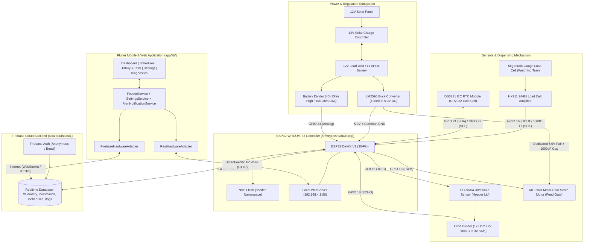
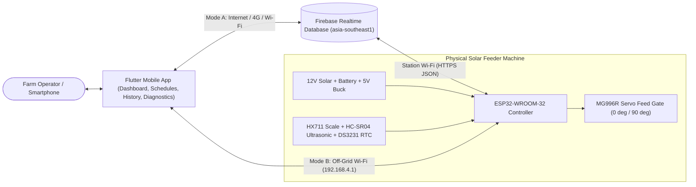
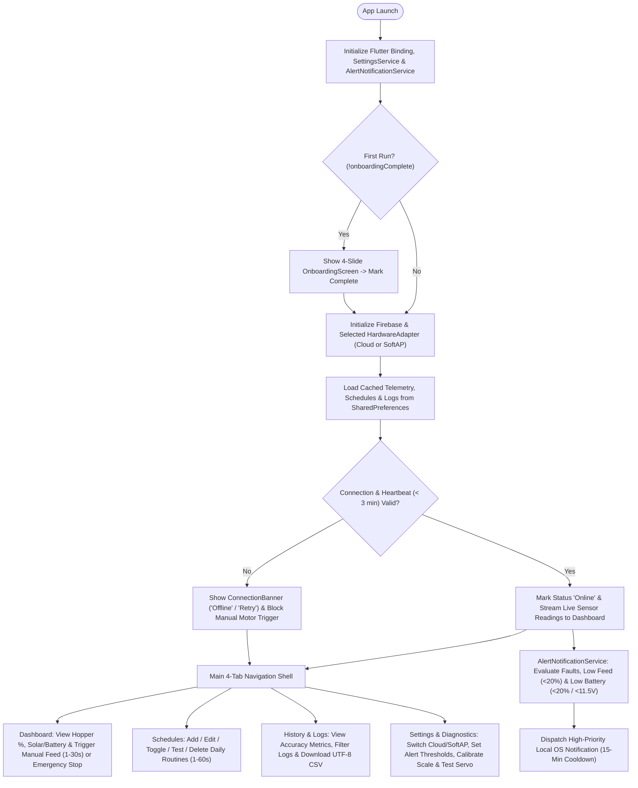
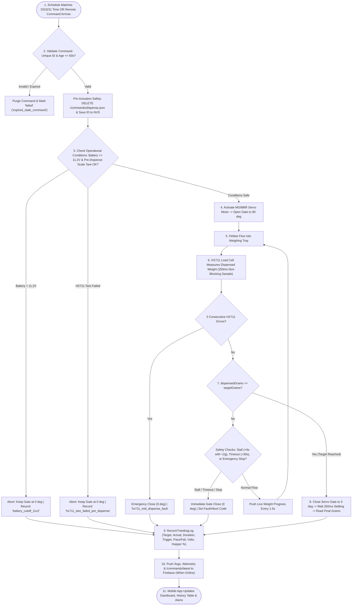
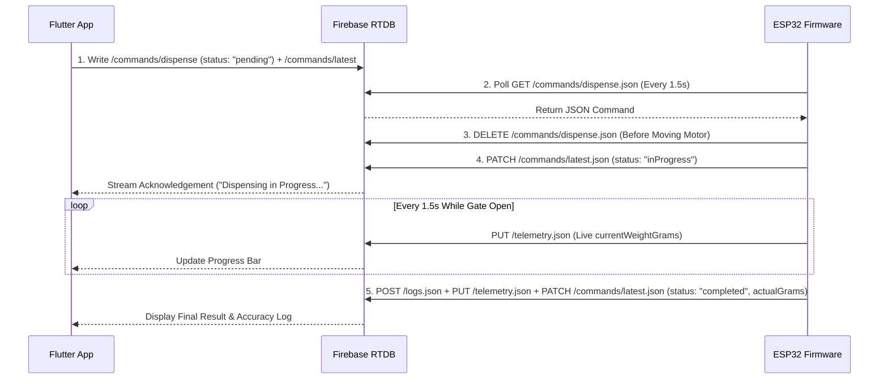
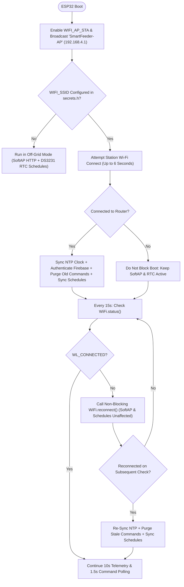
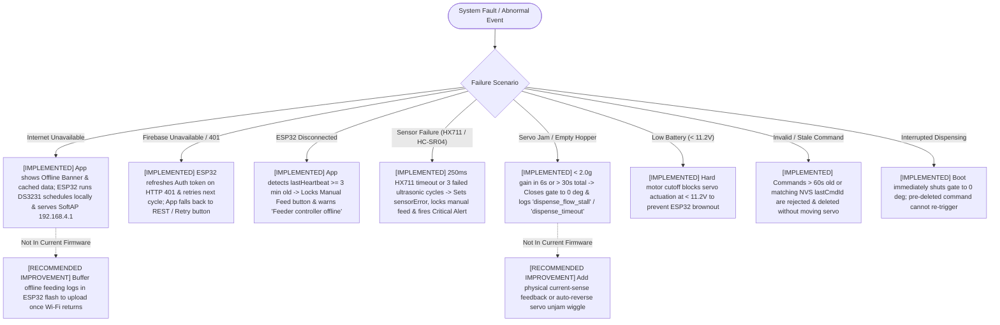

# SMART MOBILE-BASED SOLAR-POWERED CHICKEN FEEDING SYSTEM WITH AUTOMATED DISPENSING AND REAL-TIME ALERTS

**Master Technical Documentation, Non-Programmer Setup Guide, and Operational User Manual**

- **Official Repository:** https://github.com/Jehooooo/SMART-MOBILE-BASED-SOLAR-POWERED-CHICKEN-FEEDING-SYSTEM
- **Application Version:** `1.0.0+1` (`com.smartfeeder.smart_chicken_feeder`)
- **Controller Target:** ESP32-WROOM-32 (`esp32dev`, Arduino / PlatformIO Framework)
- **Cloud Backend:** Google Firebase Authentication & Firebase Realtime Database (`asia-southeast1`)
- **Companion Flowchart Suite:** [docs/SYSTEM_FLOWCHART.md](SYSTEM_FLOWCHART.md)

---

## Master Table of Contents

- [Quick Glossary for Non-Programmers](#quick-glossary-for-non-programmers)
- [Implementation & Verification Status Legend](#implementation--verification-status-legend)
- [Chapter 1: Project Overview](#chapter-1-project-overview)
  - [1.1 Project Introduction](#11-project-introduction)
  - [1.2 Purpose and Objectives](#12-purpose-and-objectives)
  - [1.3 Scope and Limitations](#13-scope-and-limitations)
  - [1.4 Main Features & Implementation Matrix](#14-main-features--implementation-matrix)
  - [1.5 System Capabilities](#15-system-capabilities)
  - [1.6 Technologies and Frameworks Used](#16-technologies-and-frameworks-used)
  - [1.7 How the Entire System Works (Plain-English Walkthrough)](#17-how-the-entire-system-works-plain-english-walkthrough)
  - [1.8 System Architecture Overview](#18-system-architecture-overview)
- [Chapter 2: System Architecture and Components](#chapter-2-system-architecture-and-components)
  - [2.1 Complete Hardware and Software Architecture Diagram](#21-complete-hardware-and-software-architecture-diagram)
  - [2.2 Component Descriptions and Individual Responsibilities](#22-component-descriptions-and-individual-responsibilities)
  - [2.3 Verified ESP32 GPIO Pin Assignment Matrix](#23-verified-esp32-gpio-pin-assignment-matrix)
  - [2.4 Communication Protocols and End-to-End Data Flow](#24-communication-protocols-and-end-to-end-data-flow)
- [Chapter 3: Complete System Flowcharts](#chapter-3-complete-system-flowcharts)
  - [3.1 Overall System Flowchart](#31-overall-system-flowchart)
  - [3.2 Mobile Application Flowchart](#32-mobile-application-flowchart)
  - [3.3 Automated Feeding Flowchart](#33-automated-feeding-flowchart)
  - [3.4 Firebase Communication Flowchart](#34-firebase-communication-flowchart)
  - [3.5 Wi-Fi Connection Flowchart](#35-wi-fi-connection-flowchart)
  - [3.6 Error Handling Flowchart](#36-error-handling-flowchart)
- [Chapter 4: Firebase Configuration Guide](#chapter-4-firebase-configuration-guide)
  - [4.1 Security Rules & Who Needs This Chapter](#41-security-rules--who-needs-this-chapter)
  - [4.2 Step-by-Step Firebase Setup Tutorial (Steps 1–12)](#42-step-by-step-firebase-setup-tutorial-steps-112)
  - [4.3 Actual Database Schema and Example JSON Payloads](#43-actual-database-schema-and-example-json-payloads)
  - [4.4 Common Firebase Errors and Solutions](#44-common-firebase-errors-and-solutions)
- [Chapter 5: Frontend and Backend Communication](#chapter-5-frontend-and-backend-communication)
  - [5.1 Operation 1: Flutter Application Initialization](#51-operation-1-flutter-application-initialization)
  - [5.2 Operation 2: Firebase Core & Authentication Initialization](#52-operation-2-firebase-core--authentication-initialization)
  - [5.3 Operation 3: Database Connection & Dual-Transport Strategy](#53-operation-3-database-connection--dual-transport-strategy)
  - [5.4 Operation 4: Reading Live Sensor Telemetry](#54-operation-4-reading-live-sensor-telemetry)
  - [5.5 Operation 5: Sending Manual Feeding & Emergency Stop Commands](#55-operation-5-sending-manual-feeding--emergency-stop-commands)
  - [5.6 Operation 6: Configuring Feeding Schedules](#56-operation-6-configuring-feeding-schedules)
  - [5.7 Operation 7: Receiving Machine Status & Online Heartbeat](#57-operation-7-receiving-machine-status--online-heartbeat)
  - [5.8 Operation 8: Updating Feeding History & CSV Export](#58-operation-8-updating-feeding-history--csv-export)
  - [5.9 Operation 9: Handling Real-Time Changes & Local OS Alerts](#59-operation-9-handling-real-time-changes--local-os-alerts)
  - [5.10 Operation 10: Handling Communication Failures & Offline Caching](#510-operation-10-handling-communication-failures--offline-caching)
- [Chapter 6: ESP32 and Machine Configuration](#chapter-6-esp32-and-machine-configuration)
  - [6.1 What Is the ESP32? (Plain-English Introduction)](#61-what-is-the-esp32-plain-english-introduction)
  - [6.2 Required Hardware Components, Cables, and Tools](#62-required-hardware-components-cables-and-tools)
  - [6.3 Critical Electrical & Power Safety Warnings](#63-critical-electrical--power-safety-warnings)
  - [6.4 Step-by-Step Firmware Setup, Configuration & Upload (Steps 1–14)](#64-step-by-step-firmware-setup-configuration--upload-steps-114)
  - [6.5 Testing Individual Sensors, the Servo Motor, and Firebase Sync](#65-testing-individual-sensors-the-servo-motor-and-firebase-sync)
- [Chapter 7: Physical Machine and Mobile Application Integration](#chapter-7-physical-machine-and-mobile-application-integration)
  - [7.1 Hardware Assembly](#71-hardware-assembly)
  - [7.2 Initial Machine Configuration](#72-initial-machine-configuration)
  - [7.3 Wi-Fi Configuration & Actual Dual-Mode Behavior](#73-wi-fi-configuration--actual-dual-mode-behavior)
  - [7.4 Mobile Application Connection](#74-mobile-application-connection)
  - [7.5 Complete Integration Test Checklist](#75-complete-integration-test-checklist)
- [Chapter 8: Android Installation and User Guide](#chapter-8-android-installation-and-user-guide)
- [Chapter 9: Application Feature User Manual](#chapter-9-application-feature-user-manual)
- [Chapter 10: Troubleshooting Guide](#chapter-10-troubleshooting-guide)
- [Chapter 11: Maintenance and Safety](#chapter-11-maintenance-and-safety)
- [Chapter 12: Testing and Validation](#chapter-12-testing-and-validation)
- [Chapter 13: Configuration Reference](#chapter-13-configuration-reference)
- [Chapter 14: Frequently Asked Questions (FAQ)](#chapter-14-frequently-asked-questions-faq)

---

## Quick Glossary for Non-Programmers

If you do not have a programming or electronics background, use this plain-language reference whenever technical terms appear:

| Term | Plain-English Meaning |
| :--- | :--- |
| **APK (`.apk` file)** | An installation file for Android phones (similar to an `.exe` installer on Windows). Does **not** work on iPhones. |
| **Buck Converter (`LM2596`)** | A small voltage-step-down board that safely reduces the 12-volt battery power down to 5.0 volts for the electronics and motor. |
| **Calibration / Tare** | **Tare** resets the weighing scale to `0.0 grams` when the tray is empty. **Calibration** teaches the scale what a known weight (like a 500g water bottle) feels like so future portions are accurate. |
| **ESP32** | The small computer board ("brain") inside the feeder box that reads the sensors, moves the feed gate motor, and talks to Wi-Fi. |
| **Firebase Realtime Database** | Google's secure cloud storage that acts as a live message board between your phone and the ESP32 over the internet. |
| **Firmware** | The permanent control program uploaded onto the ESP32 board from a computer via a USB cable. |
| **GPIO Pin** | One of the numbered metal pins along the edges of the ESP32 board where wires from sensors and motors connect. |
| **Heartbeat** | A regular "I am alive" timestamp sent by the ESP32 every 10 seconds so the mobile app knows the machine has power and internet. |
| **Load Cell & `HX711`** | The metal weighing bar (**load cell**) under the feed tray and its signal amplifier board (**HX711**) that measure dispensed feed in grams. |
| **NVS (Non-Volatile Storage)** | Permanent memory inside the ESP32 chip that remembers your schedules and scale calibration even if the battery is unplugged. |
| **PWA (Progressive Web App)** | A web version of the app that iPhone/iPad users can save directly onto their Home Screen from Safari without using the App Store. |
| **RTC (`DS3231`)** | A coin-battery-backed digital clock module that keeps accurate time even if farm Wi-Fi and main power are turned off. |
| **Servo Motor (`MG996R`)** | A motorized arm that rotates to exact angles (`0°` closed, `90°` open) to open and shut the feed chute gate. |
| **SoftAP (Direct Wi-Fi Mode)** | A built-in Wi-Fi hotspot (`SmartFeeder-AP`) broadcast directly by the feeder machine so your phone can control it nearby with zero internet. |
| **Telemetry** | Live sensor measurements sent from the feeder to your phone (feed hopper percentage, battery voltage, tray weight, solar status). |
| **Ultrasonic Sensor (`HC-SR04`)** | A distance sensor mounted under the top hopper lid that bounces sound waves off the feed pellets to measure how full the container is. |

---

## Implementation & Verification Status Legend

To guarantee strict academic and engineering transparency, every capability in this manual is classified using six explicit status labels:

- **`IMPLEMENTED`** — Code is written and active in `app/` or `firmware/`.
- **`TESTED`** — Verified by automated software tests (`24/24` Flutter tests passing) and firmware compilation (`pio run` exit code `0`).
- **`PARTIALLY IMPLEMENTED`** — Core capability works, with specific platform constraints documented (e.g., iOS native unsigned CI build vs. working Safari PWA).
- **`NOT IMPLEMENTED`** — Intentionally excluded from system scope (e.g., live camera streaming, multi-farm cloud user management, background push server).
- **`NOT VERIFIED`** — Software/firmware logic is implemented, **but physical bench/coop testing with live hardware is required** to confirm real-world mechanical/electrical metrics.
- **`RECOMMENDED IMPROVEMENT`** — Optional enhancement not currently coded, clearly separated from existing features.

---

## Chapter 1: Project Overview

### 1.1 Project Introduction

Poultry farming in rural and off-grid agricultural communities faces two persistent operational challenges: inconsistent manual feeding schedules—which lead to feed wastage or uneven flock growth—and unreliable grid electricity or rural internet connectivity.

The **Smart Mobile-Based Solar-Powered Chicken Feeding System with Automated Dispensing and Real-Time Alerts** solves these problems by combining a **12V solar-charged off-grid power subsystem**, an **ESP32-WROOM-32 embedded controller** with closed-loop load-cell weighing and ultrasonic hopper sensing, **Firebase Realtime Database** cloud synchronization, and a cross-platform **Flutter mobile application**. Whether the farmer is miles away using mobile data or standing beside an off-grid coop with no internet at all, the feeder delivers measured rations on schedule and alerts the operator when feed or battery reserves run low.

### 1.2 Purpose and Objectives

1. **Automate Poultry Ration Dispensing:** Eliminate missed or late feedings using programmable daily schedules backed by an onboard DS3231 Real-Time Clock (`RTC`) and non-volatile flash memory (`NVS`).
2. **Ensure Portion Accuracy:** Measure dispensed feed in real time using a `5 kg` strain-gauge load cell and `HX711` 24-bit amplifier, closing the `MG996R` servo gate automatically once the target gram weight is reached (with timed fallback when operating in duration mode).
3. **Operate Independently of Grid Power:** Run 24/7 on a `12V` solar panel, solar charge controller, rechargeable `12V` battery, and `5.0V` `LM2596` buck regulator, protected by an `11.2V` deep-discharge motor lockout.
4. **Provide Real-Time Remote Monitoring & Alerts:** Stream hopper level (`%`, estimated `kg`, estimated supply days), battery state (`%`, `Volts`, solar charging state), and fault alerts to the user's smartphone.
5. **Guarantee Off-Grid Resilience:** Support **Dual-Mode Connectivity**—switching seamlessly between **Firebase Realtime Cloud** (remote access from anywhere) and **Direct Wi-Fi HTTP SoftAP** (`SmartFeeder-AP` at `http://192.168.4.1` with zero internet required).
6. **Support Empirical Research & Thesis Evaluation:** Log target weight, actual weight, gram variance, percentage accuracy, battery voltage, and hopper depth for every cycle, with one-tap `CSV` export formatted for Microsoft Excel and SPSS.

### 1.3 Scope and Limitations

#### Within Project Scope
- Single-unit smart poultry pellet/crumble feeder controlled by an `ESP32-WROOM-32`.
- Automated daily time-based scheduling (up to `16` concurrent schedules stored on-device in ESP32 NVS).
- Remote manual dispensing (`1–30 seconds` / `~20g–600g` from Dashboard) and immediate mid-cycle Emergency Stop.
- Real-time ultrasonic hopper level sensing (`5.0 cm` full to `30.0 cm` empty), load-cell tray weighing, and `12V` battery voltage telemetry.
- Android native APK installation (`Android 6.0+` / API 21+) and browser/iOS Safari PWA access for Cloud mode.
- Local hardware diagnostics and 2-point scale calibration wizard inside the mobile app.

#### System Limitations (Verified Against Implementation)
1. **Wi-Fi Frequency Band:** The ESP32 radio supports **2.4 GHz Wi-Fi only** (`802.11 b/g/n`). It cannot connect to `5 GHz`-only routers unless a `2.4 GHz` band is enabled.
2. **Foreground/Active Stream Notifications (`PARTIALLY IMPLEMENTED`):** Local OS notifications (`flutter_local_notifications`) are evaluated whenever the mobile app is running or streaming telemetry from Firebase/SoftAP. Firebase Cloud Functions / FCM server-push background wakes when the app is completely force-closed are **not implemented** (kept serverless on the free Firebase Spark plan).
3. **Pellet Consistency Requirement:** Mechanical gravity-gate dispensing works best with dry poultry pellets or uniform crumbles; wet mash can bridge inside the hopper and trigger the `6-second` flow-stall safety cutoff.
4. **iOS Direct SoftAP Limitation:** On iPhones running the HTTPS-hosted Web App (PWA), Apple Safari blocks insecure local HTTP requests (`http://192.168.4.1`) due to browser Mixed-Content security rules. iOS users can use **Firebase Cloud Mode** inside the PWA, or open `http://192.168.4.1` directly in a new Safari tab when connected to `SmartFeeder-AP` to use the ESP32's built-in HTML control page.
5. **Single Shared Feeder Namespace by Default:** Both the ESP32 firmware and mobile app default to the root database paths (`/telemetry`, `/commands`, `/schedules`, `/logs`), meaning all phones signed into the same Firebase project monitor and control the same feeder unit.

### 1.4 Main Features & Implementation Matrix

| Feature | Repository Location | Implementation Status | Verification Status |
| :--- | :--- | :--- | :--- |
| **Live Telemetry Dashboard** (Hopper %, kg, days left, Solar status, Battery V/%) | `app/lib/screens/dashboard_screen.dart` | `IMPLEMENTED` | `TESTED` (Software) / `NOT VERIFIED` (Live Hardware) |
| **Closed-Loop Gravimetric Dispensing** (`HX711` weight feedback + settle read) | `firmware/src/main.cpp` (`dispenseFeed`) | `IMPLEMENTED` | `TESTED` (Compile) / `NOT VERIFIED` (Physical Feed) |
| **Timed Duration Dispensing** (`1–60s` @ `~20g/s` fallback) | `firmware/src/main.cpp` (`dispenseFeedDuration`) | `IMPLEMENTED` | `TESTED` (Compile) / `NOT VERIFIED` (Physical Feed) |
| **Remote Manual Feed & Emergency Stop** | `app/lib/services/feeder_service.dart`, `main.cpp` | `IMPLEMENTED` | `TESTED` (24/24 Automated Suite) |
| **Autonomous Offline Scheduling** (`DS3231` RTC + NVS `lastSchSlot` lock) | `firmware/src/main.cpp` (`checkAutonomousSchedules`) | `IMPLEMENTED` | `TESTED` (Compile) / `NOT VERIFIED` (Bench Power-Cycle) |
| **Dual-Mode Connectivity** (Firebase Cloud + `SmartFeeder-AP` `192.168.4.1`) | `firebase_hardware_adapter.dart`, `rest_hardware_adapter.dart`, `main.cpp` | `IMPLEMENTED` | `TESTED` (Loopback Socket Tests) |
| **Embedded Standalone Web Portal** (`GET http://192.168.4.1/`) | `firmware/src/main.cpp` (`handleRootPortal`) | `IMPLEMENTED` | `TESTED` (Compile) |
| **Safety Interlocks** (`0°` boot close, `11.2V` battery lock, `6s` stall, `30s` timeout, `60s` stale cmd purge) | `firmware/src/main.cpp`, `firmware/include/config.h` | `IMPLEMENTED` | `TESTED` (Code Audit & Compile) |
| **2-Point Scale Calibration & Servo Sweep Suite** | `app/lib/screens/diagnostics_screen.dart` | `IMPLEMENTED` | `TESTED` (Loopback Socket Tests) |
| **Feeding History Analytics & UTF-8 BOM CSV Export** | `app/lib/screens/history_screen.dart`, `file_exporter_io.dart` | `IMPLEMENTED` | `TESTED` (Software) |
| **Local Safety Notifications** (`15-min` cooldown + `+2%` hysteresis) | `app/lib/services/alert_notification_service.dart` | `IMPLEMENTED` | `TESTED` (Unit Tests) |
| **Cloud Server Push When App Force-Killed** (FCM Backend Server) | — | `NOT IMPLEMENTED` | Serverless design (No Cloud Functions) |

### 1.5 System Capabilities

- **Dispensing Capacity:** Configurable hopper capacity preset in app (`3.0 kg`, `5.0 kg` standard, `10.0 kg`, or `15.0 kg`).
- **Schedule Capacity:** Up to `16` daily routines persisted simultaneously in ESP32 NVS flash, with per-day-of-week bitmask support (`1 = Monday` through `7 = Sunday`).
- **Telemetry Cadence:** Every `10 seconds` during standby (`TELEMETRY_INTERVAL_MS = 10000`), accelerating to every `1.5 seconds` during active dispensing (`DISPENSE_STREAM_MS = 1500`).
- **Command Poll Latency:** ESP32 polls `/commands/dispense.json` every `1.5 seconds` (`COMMAND_POLL_MS = 1500`) over HTTPS, or responds instantaneously (`< 50 ms`) in Direct Wi-Fi SoftAP mode.
- **Heartbeat Freshness Window:** Mobile app marks the feeder **Online** only when `lastHeartbeat` is less than `3 minutes` old (`FeederTelemetry.isOnline` in `app/lib/models/telemetry.dart`).

### 1.6 Technologies and Frameworks Used

| Layer | Technology / Package | Version / Target | Purpose |
| :--- | :--- | :--- | :--- |
| **Mobile & Web UI** | Flutter SDK (Dart) | Dart `>=3.5.0 <4.0.0` | Cross-platform Android APK & Web PWA with custom Liquid Glass theme |
| **Cloud SDKs (App)** | `firebase_core`, `firebase_auth`, `firebase_database` | `^4.15.0`, `^6.7.0`, `^12.6.0` | Native real-time WebSocket database streams and anonymous authentication |
| **HTTP & Caching (App)** | `http`, `shared_preferences`, `intl` | `^1.6.0`, `^2.5.6`, `^0.20.3` | Direct SoftAP REST calls, Firebase REST fallback, and offline local cache |
| **Notifications (App)** | `flutter_local_notifications` | `^22.3.1` | High-priority Android/iOS local safety alerts |
| **Embedded Firmware** | PlatformIO + Arduino Framework (`espressif32`) | C++ (`esp32dev`) | Non-blocking microcontroller firmware (`RAM 15.3%`, `Flash 53.4%`) |
| **Firmware Libraries** | `ESP32Servo`, `HX711`, `RTClib`, `ArduinoJson` | `^3.0.5`, `^0.7.5`, `^2.1.4`, `^7.2.0` | PWM gate control, 24-bit load-cell ADC, DS3231 I2C clock, JSON serialization |
| **Cloud Backend** | Firebase Realtime Database + Auth | `asia-southeast1` (Singapore) | Secure (`auth != null`) cloud state synchronization |
| **CI / Release** | GitHub Actions (`ios_build.yml`) | Ubuntu & macOS Runners | Automated Android split-ABI release APK builds & GitHub Releases |

### 1.7 How the Entire System Works (Plain-English Walkthrough)

1. **Powering Up:** Sunlight charges a `12V` battery through a solar charge controller. An `LM2596` buck converter steps that `12V` down to a steady `5.0V` to run the ESP32 controller and the `MG996R` gate motor. Immediately on startup, the ESP32 forces the feed gate closed (`0°`) so feed can never spill accidentally during a reboot.
2. **Sensing the Feeder:** Every `10 seconds`, the ESP32 checks three things:
   - How high the feed pellets are inside the hopper (using the `HC-SR04` ultrasonic sensor under the lid).
   - How many grams of feed are sitting on the weighing tray (using the `HX711` load cell).
   - How much charge is left in the `12V` battery and whether the solar panel is actively charging it (using `GPIO 34` voltage sensing).
3. **Connecting to Your Phone:**
   - **With Farm Wi-Fi (Cloud Mode):** The ESP32 sends those readings to Google Firebase in the cloud. Your phone reads them from anywhere in the world over Wi-Fi or mobile data (`4G/5G`).
   - **Without Internet (Off-Grid Mode):** The ESP32 also broadcasts its own Wi-Fi signal named **`SmartFeeder-AP`**. You can connect your Android phone directly to `SmartFeeder-AP` and switch the app to **Direct Wi-Fi HTTP** to control the machine standing nearby.
4. **Feeding the Chickens:**
   - **Scheduled Feeding:** When the onboard `DS3231` clock hits a scheduled feeding time (for example, `7:00 AM`), the ESP32 checks that battery voltage is safe (`>= 11.2V`), zeroes the scale, opens the servo gate to `90°`, watches the `HX711` scale until the target weight (or duration) is dispensed, and snaps the gate shut (`0°`). Even if Wi-Fi is completely off, scheduled feedings still happen on time!
   - **Manual Feeding:** When you tap **DISPENSE NOW** on your phone, the app sends a command to the ESP32. The ESP32 deletes the queued command before opening the motor (so a sudden power blink can never make it dispense twice), pours the feed while streaming live gram progress to your screen, closes the gate, and saves a permanent accuracy record to **History & Logs**.

### 1.8 System Architecture Overview

At an architectural level, the repository follows a **Decoupled Adapter Pattern** (`FeederHardwareAdapter` in `app/lib/services/hardware/hardware_adapter.dart`). None of the UI screens talk directly to Firebase or HTTP sockets; instead, every screen observes `FeederService`, which delegates communication to either `FirebaseHardwareAdapter` (Cloud) or `RestHardwareAdapter` (Local SoftAP). On the hardware side, `firmware/src/main.cpp` runs a deterministic, non-blocking `loop()` state machine that services both the local port-80 `WebServer` and HTTPS Firebase REST endpoints concurrently (`WIFI_AP_STA`).

---

## Chapter 2: System Architecture and Components

### 2.1 Complete Hardware and Software Architecture Diagram



### 2.2 Component Descriptions and Individual Responsibilities

| Component | Verified Model / Spec | Individual Responsibility in the System |
| :--- | :--- | :--- |
| **Mobile Application** | Flutter `3.x` (`smart_chicken_feeder` v1.0.0) | Displays real-time hopper, solar, and battery gauges; dispatches manual feed, stop, tare, calibration, and servo test commands; manages daily schedules; fires local safety notifications; exports `CSV` research logs. |
| **Microcontroller** | `ESP32-WROOM-32` (`esp32dev` 30-pin DevKit V1) | Reads all sensors, runs safety interlocks, drives the servo PWM gate, maintains NVS schedules, hosts the `SmartFeeder-AP` local server, and syncs with Firebase over Wi-Fi. |
| **Cloud Database** | Firebase Realtime Database (`asia-southeast1`) | Stores live `/telemetry`, transient `/commands/dispense` & `/commands/stop`, `/commands/latest` status acknowledgements, `/schedules`, and `/logs` behind `auth != null` security rules. |
| **Dispensing Motor** | `MG996R` High-Torque Metal-Gear Servo | Mechanically slides or rotates the hopper outlet gate between `0°` (`SERVO_CLOSED_ANGLE`) and `90°` (`SERVO_OPEN_ANGLE`). |
| **Weighing Sensor** | `5 kg` Aluminum Bar Load Cell + `HX711` 24-bit ADC | Measures exact mass (`grams`) of feed dispensed into the tray in real time for closed-loop cutoff and empirical accuracy calculation. |
| **Hopper Level Sensor** | `HC-SR04` Ultrasonic Distance Sensor | Measures empty air gap from hopper lid down to pellet surface (`5.0 cm` = `100%` full, `30.0 cm` = `0%` empty) using a 3-ping average filter. |
| **Real-Time Clock** | `DS3231` Temperature-Compensated I2C RTC + `CR2032` | Preserves accurate date and time across power cycles and internet outages so autonomous feeding schedules never drift. |
| **Solar Panel** | `12V` Monocrystalline Solar Panel | Harvests sunlight outdoors and supplies charging current to the solar charge controller during daylight hours. |
| **Solar Charge Controller** | `12V` PWM Solar Charge Controller | Regulates solar panel voltage to prevent overcharging the `12V` battery and blocks reverse current drain at night. |
| **Storage Battery** | `12V` Sealed Lead-Acid (SLA) or `LiFePO4` Battery | Buffers energy for 24/7 operation, night/rainy-day feeding, and peak servo motor current surges. |
| **Voltage Regulator** | `LM2596` DC-DC Step-Down Buck Converter | Steps `11.2V–14.4V` battery bus down to a strictly regulated **`5.0V DC`** (`<= 3A`) rail for the `MG996R` servo and ESP32 `5V/VIN` supply. |
| **Voltage Dividers** | 1) `40 kΩ / 10 kΩ` (Battery) <br> 2) `1 kΩ / 2 kΩ` (Ultrasonic Echo) | 1) Scales `0–16.5V` battery voltage by `1/5` (`5.0x` ratio) to `0–3.3V` safe for ESP32 `GPIO 34`. <br> 2) Scales `5V` `HC-SR04` ECHO pulse down to `3.3V` safe for `GPIO 18`. |

### 2.3 Verified ESP32 GPIO Pin Assignment Matrix

All pin numbers below are verified directly from [`firmware/include/config.h`](../firmware/include/config.h):

| Subsystem | Constant in `config.h` | Signal | ESP32 Pin | Logic / Supply Voltage | Critical Wiring Note |
| :--- | :--- | :--- | :--- | :--- | :--- |
| **MG996R Servo** | `PIN_SERVO` | PWM Control | **`GPIO 13`** | `3.3V` PWM; **`5.0V` Buck Power** | **Never** wire Servo `VCC` to ESP32 `3.3V` or `VIN`; wire directly to `LM2596` `5.0V` output! |
| **HX711 Scale** | `PIN_HX711_DOUT` | Data Out (`DT`) | **`GPIO 16`** | `3.3V` Logic (`VCC` 3.3V/5V) | Keep load-cell analog wires short/braided away from motor leads. |
| **HX711 Scale** | `PIN_HX711_SCK` | Serial Clock (`SCK`) | **`GPIO 17`** | `3.3V` Logic | Driven as digital output by ESP32. |
| **HC-SR04 Hopper** | `PIN_US_TRIG` | Trigger (`TRIG`) | **`GPIO 5`** | `3.3V` Output (`VCC = 5.0V`) | `HC-SR04` `VCC` requires `5.0V` rail for reliable acoustic range. |
| **HC-SR04 Hopper** | `PIN_US_ECHO` | Echo (`ECHO`) | **`GPIO 18`** | **`3.3V` Divided Input** | **Must** pass through `1 kΩ` (series) / `2 kΩ` (to GND) voltage divider! |
| **DS3231 RTC** | `PIN_RTC_SDA` | I2C Data (`SDA`) | **`GPIO 21`** | `3.3V` I2C | Insert `CR2032` backup coin cell into DS3231 holder. |
| **DS3231 RTC** | `PIN_RTC_SCL` | I2C Clock (`SCL`) | **`GPIO 22`** | `3.3V` I2C | Standard ESP32 hardware I2C clock pin. |
| **Battery Sense** | `PIN_BATTERY_ADC` | Analog Sense | **`GPIO 34`** | `0 – 3.3V` ADC (`11dB` atten.) | Input-only ADC1 pin; connect midpoint of `40 kΩ` (to `+12V`) and `10 kΩ` (to `GND`). |
| **Status LED** | `PIN_STATUS_LED` | Digital Out | **`GPIO 2`** | `3.3V` Onboard LED | Lights `HIGH` while dispensing gate is active; `LOW` when idle. |

### 2.4 Communication Protocols and End-to-End Data Flow

1. **Internal Hardware Buses (ESP32 ↔ Peripherals):**
   - **I2C (`Wire` on `GPIO 21/22`):** Bidirectional digital communication between ESP32 and `DS3231` RTC.
   - **Two-Wire Synchronous Serial (`GPIO 16/17`):** Reads 24-bit signed weight conversions from `HX711` with non-blocking `250 ms` readiness timeout.
   - **50 Hz Servo PWM (`GPIO 13`, `500–2400 µs` pulse width):** Commands `MG996R` angular position (`0°–90°`).
   - **Ultrasonic Time-of-Flight (`GPIO 5/18`):** `10 µs` trigger pulse followed by `pulseIn(..., 30000)` echo duration measurement (`distance_cm = duration_us * 0.0343 / 2`).
   - **12-Bit Calibrated Millivolt ADC (`GPIO 34`):** `analogReadMilliVolts(34)` averaged over 4 samples and multiplied by `BATTERY_DIVIDER_RATIO` (`5.0`).
2. **Cloud Transport (ESP32 ↔ Firebase ↔ Flutter):**
   - **ESP32 Side:** Uses `WiFiClientSecure` (`TLS/HTTPS`) + `HTTPClient` against Firebase IdentityToolkit REST API (`accounts:signInWithPassword` or `accounts:signUp`) to obtain a bearer `idToken`, then issues authenticated `GET`, `PUT`, `POST`, `PATCH`, and `DELETE` JSON requests to `https://<FIREBASE_HOST>/*.json?auth=<idToken>`.
   - **Flutter Side:** Uses native `FirebaseDatabase` WebSocket listeners (`onValue`) on Android/iOS/Web for sub-second push updates, with automatic fallback to HTTPS REST polling (`http` package) if native streams are unavailable.
3. **Off-Grid Direct Transport (Flutter / Browser ↔ ESP32 SoftAP):**
   - **HTTP/1.1 JSON REST over Local Wi-Fi (`http://192.168.4.1:80`):** Phone joins `SmartFeeder-AP` (`WPA2-PSK`), and `RestHardwareAdapter` polls `GET /api/telemetry` every `2 seconds` (`GET /api/logs` every `6 seconds`) while sending `POST /api/*` JSON commands directly to the ESP32.

---

## Chapter 3: Complete System Flowcharts

> **Note:** For the complete 11-diagram flowchart reference (including ESP32 internal loop timers, sensor priority evaluation, and notification latching), see the dedicated companion file [`docs/SYSTEM_FLOWCHART.md`](SYSTEM_FLOWCHART.md). The six core operational flowcharts are presented below.

### 3.1 Overall System Flowchart

Shows the end-to-end relationship between the Mobile Application, Firebase Realtime Database, ESP32 Microcontroller, and Physical Feeder Machine.



### 3.2 Mobile Application Flowchart

Covers application startup, initialization, Firebase/SoftAP connection, dashboard loading, sensor retrieval, manual feeding, scheduled feeding, settings, notifications, and error handling.



### 3.3 Automated Feeding Flowchart

Traces all 11 stages of an automated feeding cycle from schedule/command trigger through validation, safety checks, closed-loop weighing, gate shutoff, logging, Firebase sync, and mobile display:



### 3.4 Firebase Communication Flowchart

Explains how commands and telemetry flow between the Flutter App, Firebase Realtime Database, and ESP32, including how commands are written, retrieved, deleted pre-actuation, acknowledged, and completed.



### 3.5 Wi-Fi Connection Flowchart

Shows initial `WIFI_AP_STA` dual-mode setup, connection attempts, 15-second background reconnection, network failure fallback, and cloud recovery.



### 3.6 Error Handling Flowchart

Distinguishes **currently implemented** fault-handling paths in the codebase from **recommended future improvements**:



---

## Chapter 4: Firebase Configuration Guide

### 4.1 Security Rules & Who Needs This Chapter

- **If you are an ordinary end user** installing the pre-built Android APK (`v1.0.0`) onto your phone to control an already-configured feeder machine, **you can skip directly to [Chapter 8](#chapter-8-android-installation-and-user-guide)**—Firebase is already compiled into the app!
- **If you are setting up a brand-new Firebase cloud account** for your own copy of the machine (**Developer / System Administrator Setup**), follow Steps 1 through 12 below.

> **STRICT SECURITY REQUIREMENT:** Never paste real API keys, passwords, or private tokens into public documents or Git commits. Both `firmware/include/secrets.h` and `app/lib/firebase_options.dart` are protected by `.gitignore`. All examples below use safe placeholders such as `<YOUR_FIREBASE_API_KEY>`.

### 4.2 Step-by-Step Firebase Setup Tutorial (Steps 1–12)

#### Step 1: Create a Google Account (If Necessary)
1. Open your web browser (Google Chrome or Microsoft Edge) and go to https://accounts.google.com/signup.
2. Complete the form to create a free Google (`@gmail.com`) account, or use your existing Google account.

**Expected Result:** You are signed into Google in your web browser.

---

#### Step 2: Open Firebase Console
1. Go to https://console.firebase.google.com/ in your browser.
2. Sign in with your Google account if prompted.

**Expected Result:** You see the Firebase Console welcome page with a **"Create a project"** (or **"Add project"**) button.

---

#### Step 3: Create a New Firebase Project
1. Click **"Create a project"** (or **"Add project"**).
2. Enter a project name, for example: `smart-chicken-feeder`. Click **Continue**.
3. Toggle **Enable Google Analytics for this project** to **Off** (Analytics is not needed for the feeder, and turning it off makes setup faster).
4. Click **Create project**, wait ~30 seconds for provisioning, and click **Continue**.

**Expected Result:** You land on your new project's **Project Overview** dashboard in Firebase Console.

---

#### Step 4: Register the Android Application (and Web App)
1. On the **Project Overview** page, click the circular **Android icon** (`+ Add app` → Android) near the top.
2. In **Android package name**, enter the exact package ID used by this repository (`app/android/app/build.gradle.kts`):
   ```text
   com.smartfeeder.smart_chicken_feeder
   ```
3. In **App nickname (optional)**, type `Smart Chicken Feeder Android`.
4. Click **Register app**.
5. Download `google-services.json` if you plan to rebuild Android native resources (store it locally; never commit secrets publicly), then click **Next** → **Next** → **Continue to console**.
6. *(Optional for Web / iPhone PWA)* Click **`+ Add app`** → **Web (`</>`)**, name it `Smart Chicken Feeder Web`, leave Firebase Hosting unchecked for now, and click **Register app**.

**Expected Result:** Your Project Overview now lists your registered Android (and Web) app(s).

---

#### Step 5: Obtain Your Firebase Configuration Values
1. Click the **Gear icon (⚙️)** beside *Project Overview* in the top-left sidebar and click **Project settings**.
2. Under the **General** tab, scroll down to **Your apps** and record these values into a temporary private notepad on your PC:
   - **Project ID** (e.g., `smart-chicken-feeder-xxxxx`)
   - **Web API Key** (`AIza...` — shown at the top under *Web API Key*; if blank, click **Authentication** first to auto-generate it)
   - **App ID**, **Messaging Sender ID**, and **Storage Bucket**

**Expected Result:** You have your Project ID and Web API Key ready to paste into your local configuration files in Steps 9 and 10.

---

#### Step 6: Enable Firebase Realtime Database (`asia-southeast1`)
1. In the left sidebar, click **Build** → **Realtime Database**.
2. Click **Create Database**.
3. Under **Realtime Database location**, choose **Singapore (`asia-southeast1`)** (closest low-latency region for Southeast Asia; matches the repository architecture) and click **Next**.
4. Select **Start in locked mode** (we will paste the exact authenticated rules in Step 7) and click **Enable**.
5. Copy the **Database URL** shown at the top of the data viewer (for example: `https://<YOUR_PROJECT_ID>-default-rtdb.asia-southeast1.firebasedatabase.app`).

**Expected Result:** You see an empty Realtime Database tree displaying `null` under your database URL.

---

#### Step 7: Configure Database Security Rules (Without Leaving Database Public!)
1. Inside **Realtime Database**, click the **Rules** tab at the top.
2. Replace the entire contents of the editor with the repository's verified [`database.rules.json`](../database.rules.json) file:
   ```json
   {
     "rules": {
       ".read": false,
       ".write": false,
       "telemetry": {
         ".read": "auth != null",
         ".write": "auth != null",
         ".validate": "newData.hasChildren(['feedLevelPercent', 'batteryVolts', 'status'])"
       },
       "commands": {
         ".read": "auth != null",
         ".write": "auth != null",
         "dispense": {
           ".validate": "!newData.exists() || (newData.hasChildren(['action']) && newData.child('action').isString())"
         }
       },
       "schedules": {
         ".read": "auth != null",
         ".write": "auth != null"
       },
       "logs": {
         ".read": "auth != null",
         ".write": "auth != null",
         ".indexOn": ["timestamp", "triggerType", "isSuccess"],
         "$logId": {
           ".validate": "newData.hasChildren(['timestamp', 'targetGrams', 'actualGrams', 'triggerType'])"
         }
       },
       "feeders": {
         "$feederId": {
           ".read": "auth != null",
           ".write": "auth != null"
         }
       }
     }
   }
   ```
3. Click **Publish**.

> **Why These Rules Are Safe:** Root `.read` and `.write` are `false`, blocking anonymous unauthenticated bots on the public internet from wiping or tampering with your database. Only clients holding a valid Firebase Authentication token (`auth != null`) can read/write feeder nodes, and `.validate` rules block malformed payloads.

**Expected Result:** Firebase displays *"Rules published"* with zero syntax errors.

---

#### Step 8: Enable Firebase Authentication (Anonymous + Email/Password)
Both the Flutter mobile app (`FirebaseAuth.instance.signInAnonymously()`) and the ESP32 (`ensureFirebaseIdToken()` in `firmware/src/main.cpp`) authenticate with Firebase Auth before reading or writing database paths!
1. In the left sidebar, click **Build** → **Authentication** → **Get started**.
2. On the **Sign-in method** tab, click **Anonymous**, toggle **Enable** to **On**, and click **Save**.
3. *(Recommended for dedicated ESP32 device credentials)* Click **Add new provider** → **Email/Password**, toggle **Enable** to **On**, and click **Save**. Then switch to the **Users** tab → click **Add user** → create a device account such as `esp32-feeder@yourdomain.com` with a strong password. *(If you leave Email/Password blank in `secrets.h`, the ESP32 automatically falls back to Anonymous Sign-Up.)*

**Expected Result:** Under **Authentication → Sign-in method**, **Anonymous** (and optionally **Email/Password**) show status **Enabled**.

---

#### Step 9: Configure ESP32 Firebase Credentials *(Developer Step)*
1. On your computer inside the repository folder, copy the template file `firmware/include/secrets.example.h` to create `firmware/include/secrets.h`.
2. Open `firmware/include/secrets.h` in Notepad or VS Code and fill in your values (note that `FIREBASE_DATABASE_URL` has **no** `https://` and **no** trailing slash, matching `secrets.example.h`):
   ```cpp
   #pragma once

   // 2.4 GHz Farm Wi-Fi Credentials
   #define WIFI_SSID               "<YOUR_2.4GHZ_WIFI_NAME>"
   #define WIFI_PASSWORD           "<YOUR_WIFI_PASSWORD>"

   // Firebase Realtime Database Host (WITHOUT https:// or trailing /)
   #define FIREBASE_DATABASE_URL   "<YOUR_PROJECT_ID>-default-rtdb.asia-southeast1.firebasedatabase.app"
   #define FIREBASE_API_KEY        "<YOUR_FIREBASE_WEB_API_KEY>"

   // Optional: Device Email/Password created in Step 8 (leave "" to use Anonymous Auth)
   #define FIREBASE_USER_EMAIL     ""
   #define FIREBASE_USER_PASSWORD  ""
   ```
3. Save `firmware/include/secrets.h`.

**Expected Result:** `firmware/include/secrets.h` exists locally and is automatically ignored by Git so your keys stay private.

---

#### Step 10: Configure Flutter Firebase Integration *(Developer Step)*
If you are compiling the Flutter app from source for your own Firebase project:
1. Create or edit `app/lib/firebase_options.dart` (git-ignored) using the values from Step 5 and Step 6:
   ```dart
   import 'package:firebase_core/firebase_core.dart' show FirebaseOptions;
   import 'package:flutter/foundation.dart'
       show defaultTargetPlatform, kIsWeb, TargetPlatform;

   class DefaultFirebaseOptions {
     static FirebaseOptions get currentPlatform {
       if (kIsWeb) return web;
       switch (defaultTargetPlatform) {
         case TargetPlatform.android:
           return android;
         case TargetPlatform.iOS:
           return ios;
         default:
           return web;
       }
     }

     static const FirebaseOptions web = FirebaseOptions(
       apiKey: '<YOUR_FIREBASE_WEB_API_KEY>',
       appId: '<YOUR_WEB_APP_ID>',
       messagingSenderId: '<YOUR_SENDER_ID>',
       projectId: '<YOUR_PROJECT_ID>',
       authDomain: '<YOUR_PROJECT_ID>.firebaseapp.com',
       databaseURL: 'https://<YOUR_PROJECT_ID>-default-rtdb.asia-southeast1.firebasedatabase.app',
       storageBucket: '<YOUR_PROJECT_ID>.firebasestorage.app',
     );

     static const FirebaseOptions android = FirebaseOptions(
       apiKey: '<YOUR_FIREBASE_ANDROID_API_KEY>',
       appId: '<YOUR_ANDROID_APP_ID>',
       messagingSenderId: '<YOUR_SENDER_ID>',
       projectId: '<YOUR_PROJECT_ID>',
       databaseURL: 'https://<YOUR_PROJECT_ID>-default-rtdb.asia-southeast1.firebasedatabase.app',
       storageBucket: '<YOUR_PROJECT_ID>.firebasestorage.app',
     );

     static const FirebaseOptions ios = FirebaseOptions(
       apiKey: '<YOUR_FIREBASE_IOS_API_KEY>',
       appId: '<YOUR_IOS_APP_ID>',
       messagingSenderId: '<YOUR_SENDER_ID>',
       projectId: '<YOUR_PROJECT_ID>',
       databaseURL: 'https://<YOUR_PROJECT_ID>-default-rtdb.asia-southeast1.firebasedatabase.app',
       storageBucket: '<YOUR_PROJECT_ID>.firebasestorage.app',
       iosBundleId: 'com.smartfeeder.smartChickenFeeder',
     );
   }
   ```
   *(Alternatively, run `flutterfire configure` via the Firebase CLI to generate `app/lib/firebase_options.dart` automatically.)*

**Expected Result:** Running `cd app; dart analyze lib/` reports **No issues found!**

---

#### Step 11: Seed or Inspect Initial Database Structure (Optional)
You do not need to manually type data into Firebase—as soon as the ESP32 boots and connects to Wi-Fi, it automatically creates `/telemetry`! If you wish to inspect the clean schema template, see [`data.json`](../data.json) in the repository root.

---

#### Step 12: Test Connectivity and Verify App ↔ ESP32 Synchronization
1. Power on the flashed ESP32 (see [Chapter 6](#chapter-6-esp32-and-machine-configuration)).
2. Open **Firebase Console → Realtime Database → Data**. Within `10 seconds`, you should see `/telemetry` light up green and update `lastHeartbeat`.
3. Open the **Smart Chicken Feeder** mobile app on your phone. Confirm the top-right badge turns green and says **`Online`**.
4. In the app's **Schedules** tab, add a test schedule. Watch `/schedules` appear immediately inside Firebase Console, and within `30 seconds` observe `[Cloud] Synced 1 schedule(s) from Firebase -> NVS` in the ESP32 Serial Monitor.

**Expected Result:** Live data flows both ways between the phone, Firebase Realtime Database, and the ESP32!

---

### 4.3 Actual Database Schema and Example JSON Payloads

Below is an exact snapshot of the production Firebase Realtime Database tree generated by `firmware/src/main.cpp` and `app/lib/services/hardware/firebase_hardware_adapter.dart`:

```json
{
  "telemetry": {
    "feedLevelPercent": 84.0,
    "batteryVolts": 12.68,
    "batteryPercent": 92,
    "currentWeightGrams": 0.0,
    "status": "idle",
    "isSolarCharging": true,
    "lastHeartbeat": 1761840000000,
    "lastFedTimestamp": 1761820200000,
    "lastFedGrams": 100.4
  },
  "commands": {
    "dispense": {
      "id": "cmd_1761840050123",
      "action": "DISPENSE",
      "durationSeconds": 5,
      "targetGrams": 100.0,
      "triggerType": "Manual",
      "timestamp": 1761840050123,
      "status": "pending"
    },
    "latest": {
      "id": "cmd_1761840050123",
      "action": "DISPENSE",
      "durationSeconds": 5,
      "targetGrams": 100.0,
      "actualGrams": 100.8,
      "status": "completed",
      "updatedAt": 1761840056000
    }
  },
  "schedules": {
    "sch_1761800000000": {
      "label": "Morning Feeding",
      "hour": 7,
      "minute": 0,
      "durationSeconds": 5,
      "targetGrams": 100.0,
      "isEnabled": true,
      "daysOfWeek": [1, 2, 3, 4, 5, 6, 7]
    }
  },
  "logs": {
    "-Of9xSamplePushKey": {
      "timestamp": 1761820200000,
      "targetGrams": 100.0,
      "actualGrams": 100.4,
      "durationSeconds": 5,
      "triggerType": "Schedule (Morning Feeding)",
      "isSuccess": true,
      "batteryVolts": 12.65,
      "feedLevelPercent": 84.0
    }
  }
}
```

### 4.4 Common Firebase Errors and Solutions

| Firebase Error / Symptom | Root Cause | Exact Fix |
| :--- | :--- | :--- |
| **`HTTP 401 Unauthorized`** in ESP32 Serial Monitor or *"permission denied"* banner in App | **Anonymous** (or **Email/Password**) sign-in provider is disabled in Firebase Console, or `FIREBASE_API_KEY` is wrong. | Enable **Anonymous** in **Firebase Console → Authentication → Sign-in method** and verify `FIREBASE_API_KEY` in `secrets.h`. |
| **`HTTP 400 Bad Request`** when writing `/telemetry` or `/logs` | Payload missing a required field enforced by `.validate` in `database.rules.json`. | Ensure `database.rules.json` matches Step 7 and firmware is unmodified. |
| **ESP32 prints `Firebase Auth failed: -1`** | `FIREBASE_DATABASE_URL` includes `https://` or ESP32 Wi-Fi has no internet access (captive portal / DNS failure). | Remove `https://` and any trailing `/` from `FIREBASE_DATABASE_URL` in `secrets.h`; verify router has internet. |
| **App connects to Firebase, but says `Feeder controller offline`** | Firebase Cloud works, **but** `/telemetry/lastHeartbeat` is `null` or `>= 3 minutes` old because the ESP32 is off or disconnected from Wi-Fi. | Power on the ESP32 and verify `[WiFi] Connected!` + `[Firebase] Authenticated` in Serial Monitor. |

---

## Chapter 5: Frontend and Backend Communication

This chapter traces all **10 core communication operations** across the Flutter frontend (`app/lib/`), Firebase Realtime Database, and ESP32 firmware (`firmware/src/main.cpp`), referencing exact classes and source files without modifying any implementation code.

### 5.1 Operation 1: Flutter Application Initialization
- **Trigger:** User taps the **Smart Chicken Feeder** icon on Android or opens the Web App URL.
- **Handling Component:** `main()` and `_SmartFeederAppBootstrapState._initializeServices()` in [`app/lib/main.dart`](../app/lib/main.dart).
- **Database Path / Storage:** Local device `SharedPreferences` (`smart_feeder_settings.json` backup on IO platforms).
- **Transmitted Data:** Loads `theme_mode`, `feeder_name`, `low_feed_threshold`, `low_battery_threshold`, `hopper_capacity_kg`, `onboarding_complete`, and `hardware_transport`. Initializes `AlertNotificationService`.
- **Expected Response:** Returns populated `SettingsService` instance and requests Android `POST_NOTIFICATIONS` permission on supported mobile OS versions.
- **UI Display:** Shows branded splash screen while initializing, then routes to `OnboardingScreen` (if first launch) or `MainNavigationShell`.

### 5.2 Operation 2: Firebase Core & Authentication Initialization
- **Trigger:** Immediately during `_initializeServices()` in `app/lib/main.dart` and `FirebaseHardwareAdapter.initialize()` in [`app/lib/services/hardware/firebase_hardware_adapter.dart`](../app/lib/services/hardware/firebase_hardware_adapter.dart).
- **Handling Component:** `Firebase.initializeApp(options: DefaultFirebaseOptions.currentPlatform)` followed by `FirebaseAuth.instance.signInAnonymously()` (with HTTPS REST fallback to `identitytoolkit.googleapis.com/v1/accounts:signUp?key=...`).
- **Database Path / Endpoint:** Firebase Auth IdentityToolkit service.
- **Transmitted Data:** `{"returnSecureToken": true}` (REST fallback) or native SDK anonymous credential request.
- **Expected Response:** Authenticated `UserCredential` / `idToken` satisfying `"auth != null"` in `database.rules.json`.
- **UI Display:** Transitions `FeederConnection` from `connecting` to `online` once the first RTDB listener responds; if auth fails (e.g., disabled in console), `ConnectionBanner` displays the exact permission error with a **Retry** button.

### 5.3 Operation 3: Database Connection & Dual-Transport Strategy
- **Trigger:** Startup adapter binding (`FeederService`) or user changing **Hardware Transport** dropdown in `SettingsScreen` (`_switchHardwareTransport()` in [`app/lib/screens/settings_screen.dart`](../app/lib/screens/settings_screen.dart)).
- **Handling Component:** `FeederService.switchAdapter()` in [`app/lib/services/feeder_service.dart`](../app/lib/services/feeder_service.dart) swapping between `FirebaseHardwareAdapter` and `RestHardwareAdapter` ([`app/lib/services/hardware/rest_hardware_adapter.dart`](../app/lib/services/hardware/rest_hardware_adapter.dart)).
- **Database Path / Endpoint:**
  - Cloud: `/info/connected`, `/telemetry`, `/schedules`, `/logs`, `/commands/latest`.
  - SoftAP: `GET http://192.168.4.1/api/telemetry` (every `2s`) and `GET http://192.168.4.1/api/logs` (every `6s`).
- **Expected Response:** Continuous `Stream<FeederTelemetry>`, `Stream<List<FeedingSchedule>>`, `Stream<List<FeedingLog>>`, and `Stream<FeederConnection>`.
- **UI Display:** Displays confirmation snackbar (`"Hardware transport switched to ..."`), updates header status pill, and refreshes dashboard cards.

### 5.4 Operation 4: Reading Live Sensor Telemetry
- **Trigger:** Automatic `10s` ESP32 heartbeat (`pushTelemetryToFirebase()` in `firmware/src/main.cpp` lines 1054–1086), `1.5s` mid-dispense stream, or user tapping **Sync Feeder Telemetry (`↻`)** / pulling down on `DashboardScreen`.
- **Handling Component:** ESP32 `buildTelemetryJson()` → Firebase `/telemetry` → Flutter `FeederTelemetry.fromMap()` ([`app/lib/models/telemetry.dart`](../app/lib/models/telemetry.dart)).
- **Database Path / Endpoint:** `PUT /telemetry.json` (Cloud) or `GET http://192.168.4.1/api/telemetry` (SoftAP).
- **Transmitted Data:**
  ```json
  {
    "feedLevelPercent": 85.0,
    "batteryVolts": 12.65,
    "batteryPercent": 90,
    "currentWeightGrams": 0.0,
    "status": "idle",
    "isSolarCharging": true,
    "lastHeartbeat": 1761840000000,
    "lastFedTimestamp": 1761820200000,
    "lastFedGrams": 100.4
  }
  ```
- **Expected Response:** HTTP `200 OK` on ESP32; real-time stream emission in `FeederService`.
- **UI Display:** Updates Hopper Level progress bar, `~kg remaining`, `~days left`, Solar System (`Charging`/`Idle`), Battery `%` & `Volts`, and snackbar on manual refresh.

### 5.5 Operation 5: Sending Manual Feeding & Emergency Stop Commands
- **Trigger:** User taps **`DISPENSE <X>s NOW`** → **`Confirm & Dispense`** (or **`CANCEL / EMERGENCY STOP`**) on `DashboardScreen`.
- **Handling Component:** `FeederService.triggerManualFeed()` / `cancelDispensing()` → `sendCommand()` in active adapter → `pollFirebaseCommands()` & `processIncomingCommandJson()` (`firmware/src/main.cpp` lines 919–1050) or `POST /api/dispense` / `/api/stop`.
- **Database Path / Endpoint:**
  - Cloud Dispense: Writes `/commands/dispense` and `/commands/latest`.
  - Cloud Stop: Writes `/commands/stop` and updates `/commands/dispense`.
  - SoftAP: `POST http://192.168.4.1/api/dispense` or `POST http://192.168.4.1/api/stop`.
- **Transmitted Data:**
  ```json
  {
    "id": "cmd_1761840050123",
    "action": "DISPENSE",
    "durationSeconds": 5,
    "targetGrams": 0.0,
    "triggerType": "Manual",
    "timestamp": 1761840050123,
    "status": "pending"
  }
  ```
  *(Note: When `targetGrams` is `0.0` from the duration slider, ESP32 runs `dispenseFeedDuration(durationSeconds)` while measuring actual grams on the HX711 if connected; when `targetGrams > 0`, ESP32 runs closed-loop `dispenseFeed(targetGrams)`.)*
- **Expected Response:** ESP32 **immediately `DELETE`s `/commands/dispense.json`** before actuating the servo, patches `/commands/latest` to `"inProgress"`, runs the gate, and patches `/commands/latest` to `"completed"`, `"aborted"`, or `"failed"` with `actualGrams`.
- **UI Display:** Shows green dispatch snackbar, animated blue `Dispensing in Progress...` progress banner with live weight readout, and red `CANCEL / EMERGENCY STOP` button until hardware completion.

### 5.6 Operation 6: Configuring Feeding Schedules
- **Trigger:** User adds, edits, toggles, deletes, or undoes deletion of a routine on `SchedulesScreen` ([`app/lib/screens/schedules_screen.dart`](../app/lib/screens/schedules_screen.dart)).
- **Handling Component:** `FeederService.addSchedule()` / `updateSchedule()` / `toggleSchedule()` / `deleteSchedule()` → `syncSchedules()` → ESP32 `syncSchedulesFromFirebase()` (every `30s`) or `POST /api/schedules`.
- **Database Path / Endpoint:** `/schedules` (keyed by schedule `id`, e.g., `/schedules/sch_1761800000000`) or `POST http://192.168.4.1/api/schedules`.
- **Transmitted Data:** Map of `FeedingSchedule` objects (`label`, `hour`, `minute`, `durationSeconds`, `targetGrams`, `isEnabled`, `daysOfWeek`).
- **Expected Response:** Persisted in Firebase `/schedules` and saved into ESP32 NVS (`prefs.putString("schedules", ...)`). When all schedules are deleted, `/schedules` is removed cleanly and ESP32 clears NVS (`scheduleCount = 0`).
- **UI Display:** Updates active daily routine counter, total daily runtime/grams banner, and Dashboard *"Next Automated Feeding"* countdown.

### 5.7 Operation 7: Receiving Machine Status & Online Heartbeat
- **Trigger:** Every telemetry update + periodic freshness check in `FeederService.isDeviceOnline` and `FeederTelemetry.isOnline` ([`app/lib/models/telemetry.dart`](../app/lib/models/telemetry.dart) lines 55–59).
- **Handling Component:** `FeederTelemetry.isOnline` checks `lastHeartbeat != null` and `DateTime.now().difference(lastHeartbeat!).inMinutes < 3`.
- **Database Path:** `/telemetry/status`, `/telemetry/sensorError`, and `/telemetry/lastHeartbeat`.
- **Expected Response:** Maps status string to `FeederStatus` enum (`idle`, `dispensing`, `lowFeed`, `lowBattery`, `offline`, `error`).
- **UI Display:** Updates top-right status pill (`Online` green, `Dispensing` amber, `Connecting` blue, `Offline` red) and slides down `ConnectionBanner` if heartbeat goes stale (`>= 3 minutes`).

### 5.8 Operation 8: Updating Feeding History & CSV Export
- **Trigger:** ESP32 finishes any manual or scheduled dispense (`emitFeedingLog()` in `firmware/src/main.cpp` lines 473–509), or user taps **Download Icon (`⬇`)** on `HistoryScreen`.
- **Handling Component:** ESP32 `POST /logs.json` → Flutter `FeedingLog.fromMap()` ([`app/lib/models/feeding_log.dart`](../app/lib/models/feeding_log.dart)) → `FileExporter.downloadTextFile()` ([`app/lib/services/file_export/file_exporter_io.dart`](../app/lib/services/file_export/file_exporter_io.dart)).
- **Database Path / Endpoint:** `/logs/{pushId}` (Cloud) or `GET http://192.168.4.1/api/logs` (25-entry ring buffer in SoftAP mode).
- **Transmitted Data:** `timestamp`, `targetGrams`, `actualGrams`, `durationSeconds`, `triggerType`, `isSuccess`, `batteryVolts`, `feedLevelPercent`.
- **Expected Response:** Sorted newest-first in `FeederService.history`; CSV exporter prepends UTF-8 BOM (`\uFEFF`) and writes `feeding_logs_YYYYMMDD_HHmmss.csv` to `Downloads`.
- **UI Display:** Recalculates `Total Feeds`, `Avg Accuracy (%)`, and `Total Dispensed` in the *Chapter IV Data* summary card, renders variance badges (`<= 3.0g` green), and confirms CSV file path via snackbar.

### 5.9 Operation 9: Handling Real-Time Changes & Local OS Alerts
- **Trigger:** Live telemetry or new feeding log arrives while `telemetry.isOnline == true`.
- **Handling Component:** `AlertNotificationService.evaluateTelemetry()` & `evaluateFeedingLog()` ([`app/lib/services/alert_notification_service.dart`](../app/lib/services/alert_notification_service.dart)).
- **Database Path:** Evaluates `/telemetry` (`status`, `sensorError`, `feedLevelPercent`, `batteryPercent`, `batteryVolts`) and `/logs` (`isSuccess`).
- **Expected Response:** Emits `FeederAlert` on `alertStream` and invokes `FlutterLocalNotificationsPlugin.show()` on channel `feeder_safety_alerts` (throttled by `15-minute` cooldown and `+2%` recovery hysteresis).
- **UI Display:** High-priority Android/iOS system tray alert + colored warning banner at the top of `DashboardScreen`.

### 5.10 Operation 10: Handling Communication Failures & Offline Caching
- **Trigger:** Phone loses internet, router power drops, or Firebase Auth `idToken` expires after 1 hour.
- **Handling Component:**
  - **Flutter:** `FeederService._persistStateToLocalCache()` & `_hydrateFromLocalCache()` cache last known telemetry, schedules, and up to 100 logs in `SharedPreferences`.
  - **ESP32:** `ensureFirebaseIdToken()` proactively refreshes tokens at `45 minutes` (`2,700,000 ms`) and immediately retries once if any Firebase HTTP call returns `401`. Every `15s`, `loop()` runs non-blocking `WiFi.reconnect()`.
- **UI Display:** App never crashes or shows a blank white screen—it displays cached schedules/logs immediately alongside `ConnectionBanner` (*"Showing last known data from ... Saved schedules keep running on the feeder"*) with a one-tap **Retry** button.

---

## Chapter 6: ESP32 and Machine Configuration

> **Who Needs This Chapter?** Follow this chapter if you are assembling the electronics box or uploading the firmware program onto a brand-new ESP32 board (**Developer / Technician Procedure**, written step-by-step so a beginner with zero coding experience can follow every click).

### 6.1 What Is the ESP32? (Plain-English Introduction)

The **ESP32-WROOM-32 DevKit V1** is a pocket-sized computer board inside your chicken feeder. Unlike a normal computer, it does not have a screen or keyboard—instead, you plug it into a Windows PC or laptop **one time** using a USB cable to copy the feeder's control program ("firmware") onto it. Once programmed, the ESP32 runs automatically whenever `5.0V` solar battery power is switched on.

### 6.2 Required Hardware Components, Cables, and Tools

#### Electronic & Solar Components
1. **1x ESP32-WROOM-32 Development Board** (`30-pin` DevKit V1, `esp32dev` compatible).
2. **1x MG996R Metal-Gear High-Torque Servo Motor** (`180°` positional version, **not** `360°` continuous rotation).
3. **1x 5 kg Straight Bar Load Cell + HX711 Amplifier Module**.
4. **1x HC-SR04 Ultrasonic Distance Sensor**.
5. **1x DS3231 I2C Real-Time Clock Module** + **1x CR2032 3V Coin Battery**.
6. **1x LM2596 DC-DC Step-Down Buck Converter Module** (with small brass adjustment screw).
7. **1x 12V Solar Panel** (`20W–50W` recommended) + **1x 12V PWM Solar Charge Controller** + **1x 12V Rechargeable Battery** (`7Ah–12Ah` SLA or LiFePO4).
8. **Resistors & Capacitor:**
   - For Battery Voltage Divider (`GPIO 34`): **1x `40 kΩ` resistor** (or two `20 kΩ` in series) and **1x `10 kΩ` resistor**.
   - For Ultrasonic Echo Divider (`GPIO 18`): **1x `1 kΩ` resistor** and **1x `2 kΩ` resistor** (or two `1 kΩ` in series).
   - For Servo Surge Filtering: **1x `1000 µF` (`16V` or `25V`) electrolytic capacitor** across the `5.0V` servo power rail and `GND`.

#### Required Cables and Tools
- **1x Data-Capable USB Cable** (Micro-USB or USB-C depending on your ESP32 board—**Important:** cheap "charge-only" cables from small fans/lamps do not carry data and will not show a COM port!).
- **1x Digital Multimeter** (mandatory to tune the `LM2596` buck converter to `5.0V` before connecting the ESP32).
- **1x Small Flathead Jeweler's Screwdriver** (for turning the brass screw on the `LM2596` and charge controller terminals).
- **Jumper Wires / Screw Terminal Block / Soldering Iron** + Weatherproof Enclosure (`IP65` junction box recommended for farm coops).

---

### 6.3 Critical Electrical & Power Safety Warnings

> **⚠️ WARNING 1 — TUNE THE LM2596 BUCK CONVERTER TO 5.0V BEFORE CONNECTING ANYTHING!**  
> Brand-new `LM2596` modules ship from the factory set to output the full input voltage (`12V–14V`). Connecting `12V` to the ESP32 `5V/VIN` pin or the `MG996R` servo will **instantly burn out and destroy both components**. Connect **only** the `12V` battery to `LM2596 IN+ / IN-`, place your multimeter probes on `OUT+ / OUT-`, and turn the tiny brass screw counter-clockwise (sometimes 15–20 turns) until the meter reads **`5.00V DC` (`±0.05V`)** before wiring the ESP32 or servo!

> **⚠️ WARNING 2 — NEVER POWER THE MG996R SERVO FROM AN ESP32 PIN!**  
> The `MG996R` motor pulls up to **`2.5 Amps`** when starting or pushing against pellets. Wire the servo's Red (`+`) and Brown/Black (`GND`) power wires **directly to the `LM2596` `5.0V` output terminals**, with a `1000 µF` capacitor across `+5V` and `GND`. Only the Orange/Yellow signal wire connects to ESP32 **`GPIO 13`**.

> **⚠️ WARNING 3 — COMMON GROUND (`GND`) IS MANDATORY!**  
> Every ground wire in the system (`12V` Battery `-`, `LM2596 OUT-`, ESP32 `GND`, Servo `GND`, `HX711 GND`, `HC-SR04 GND`, `DS3231 GND`, and resistor divider bottom legs) **must** tie together to one shared Ground bus. Missing common ground causes erratic servo twitching and false sensor numbers.

> **⚠️ WARNING 4 — PROTECT `GPIO 18` FROM 5V ULTRASONIC ECHO!**  
> ESP32 pins operate at `3.3V` logic and are not `5V`-tolerant. Connect `HC-SR04 ECHO` → `1 kΩ` resistor → **`GPIO 18`**, and also connect **`GPIO 18`** → `2 kΩ` resistor → **`GND`**. This safely drops the `5V` echo signal down to `3.3V`.

---

### 6.4 Step-by-Step Firmware Setup, Configuration & Upload (Steps 1–14)

The repository's firmware (`firmware/platformio.ini`) uses **Visual Studio Code + PlatformIO**, which is much easier for beginners than Arduino IDE because **PlatformIO automatically downloads the exact ESP32 board support and all 5 required libraries for you** without manual `.zip` hunting!

#### Step 1: Install Visual Studio Code (VS Code)
1. On a Windows PC with internet access, open https://code.visualstudio.com/.
2. Click **Download for Windows**, run the downloaded installer, and click **Next** → **Install** → **Finish**.

**Expected Result:** Visual Studio Code opens to its Welcome tab.

---

#### Step 2: Install the PlatformIO IDE Extension
1. Inside VS Code, click the **Extensions icon** on the left sidebar (four little squares, or press `Ctrl+Shift+X`).
2. In the search box at the top, type **`PlatformIO IDE`**.
3. Click the official **PlatformIO IDE** result (orange alien ant icon) and click the blue **Install** button.
4. Wait 2–4 minutes while PlatformIO installs its core tools in the bottom-right corner. When prompted, click **Reload Now** (or close and reopen VS Code).

**Expected Result:** An alien icon (**PlatformIO**) appears on the left sidebar of VS Code, and a small **Checkmark (`✓`)** and **Right-Arrow (`→`)** appear in the blue/bottom status bar.

---

#### Step 3: Install USB-to-Serial Driver (If Windows Does Not Recognize Your ESP32)
Most ESP32 boards use a small USB chip (`CP2102` or `CH340`).
1. Plug your ESP32 into your PC's USB port.
2. Right-click the Windows **Start** button → click **Device Manager** → expand **Ports (COM & LPT)**.
3. If you see `Silicon Labs CP210x USB to UART Bridge (COM3)` or `USB-SERIAL CH340 (COM4)`, **your driver is already installed**—note that `COM` number!
4. If instead you see a yellow warning triangle under *Other devices*, download and install the Silicon Labs **CP210x Universal Windows Driver** (or WCH **CH341SER** driver), unplug the ESP32, and plug it back in.

**Expected Result:** Windows Device Manager shows a valid `COM` port (for example, `COM3`, `COM4`, or `COM5`) when the ESP32 is plugged in.

---

#### Step 4: Download or Open the Project Folder
1. Download the repository from https://github.com/Jehooooo/SMART-MOBILE-BASED-SOLAR-POWERED-CHICKEN-FEEDING-SYSTEM (click the green **`<> Code`** button → **Download ZIP** → extract the ZIP to `Documents\AutomaticDispensing`).
2. In VS Code, click **File** → **Open Folder...**, select the **`firmware`** subfolder (`Documents\AutomaticDispensing\firmware`), and click **Select Folder**. *(Important: Open the `firmware` folder directly so PlatformIO immediately detects `platformio.ini`!)*

**Expected Result:** The left Explorer panel shows `include`, `src`, and `platformio.ini`. PlatformIO automatically downloads the `espressif32` board package and all required libraries listed in `platformio.ini`:
- `madhephaestus/ESP32Servo@^3.0.5`
- `bogde/HX711@^0.7.5`
- `adafruit/RTClib@^2.1.4`
- `mobizt/Firebase Arduino Client Library for ESP8266 and ESP32@^4.4.14`
- `bblanchon/ArduinoJson@^7.2.0`

---

#### Step 5: Verify Board Selection (`esp32dev`)
1. Click `platformio.ini` in the left panel to view it.
2. Confirm lines 12–15 already configure the exact board and serial speed:
   ```ini
   [env:esp32dev]
   platform = espressif32
   board = esp32dev
   framework = arduino
   monitor_speed = 115200
   ```
   You do **not** need to change anything in `platformio.ini`.

**Expected Result:** PlatformIO bottom bar shows `Default (firmware)` / `env:esp32dev`.

---

#### Step 6: Create Your Private `secrets.h` File
1. In the left Explorer panel under `include/`, right-click **`secrets.example.h`** and click **Copy**.
2. Right-click the **`include`** folder and click **Paste**.
3. Right-click the copied file (`secrets.example copy.h`), click **Rename**, and name it exactly:
   ```text
   secrets.h
   ```

**Expected Result:** You now see `include/secrets.h` in the file list (greyed out slightly because Git protects it from being uploaded publicly).

---

#### Step 7: Enter Your Farm Wi-Fi and Firebase Credentials
1. Click `include/secrets.h` to open it in the editor.
2. Type your **2.4 GHz Wi-Fi name** (`WIFI_SSID`) and **Wi-Fi password** (`WIFI_PASSWORD`) inside the quotation marks.
3. Paste your `FIREBASE_DATABASE_URL` (without `https://`) and `FIREBASE_API_KEY` from [Chapter 4](#chapter-4-firebase-configuration-guide):
   ```cpp
   #pragma once

   #define WIFI_SSID               "<YOUR_2.4GHZ_WIFI_SSID>"
   #define WIFI_PASSWORD           "<YOUR_WIFI_PASSWORD>"

   #define FIREBASE_DATABASE_URL   "<YOUR_PROJECT_ID>-default-rtdb.asia-southeast1.firebasedatabase.app"
   #define FIREBASE_API_KEY        "<YOUR_FIREBASE_WEB_API_KEY>"

   #define FIREBASE_USER_EMAIL     ""
   #define FIREBASE_USER_PASSWORD  ""
   ```
   *(Note: If your farm has **zero internet** and you only plan to use off-grid Direct Wi-Fi mode, you can leave `WIFI_SSID` as `""`—the firmware will compile cleanly and run `SmartFeeder-AP`!)*
4. Press **`Ctrl+S`** to save `secrets.h`.

**Expected Result:** `secrets.h` has no unsaved dot next to its tab name.

---

#### Step 8: Review GPIO Pins and Physical Dimensions (`include/config.h`)
1. Open `include/config.h`.
2. Verify that your physical hopper height matches `HOPPER_FULL_CM` (`5.0f` cm from lid sensor when full) and `HOPPER_EMPTY_CM` (`30.0f` cm from lid sensor to bottom floor when empty). If your container is taller (for example, `45 cm` deep when empty), change `30.0f` to `45.0f` and press `Ctrl+S`.
3. Keep all GPIO pin numbers (`13`, `16`, `17`, `5`, `18`, `21`, `22`, `34`, `2`) unchanged so they match your wiring diagram.

**Expected Result:** `config.h` matches your physical container geometry.

---

#### Step 9: Test-Compile the Firmware (Checkmark Button)
1. Click the **Checkmark (`✓`PlatformIO: Build)** icon in the bottom-left blue status bar of VS Code.
2. Watch the terminal panel at the bottom compile the C++ code.

**Expected Result:** After 15–45 seconds, the terminal prints green **`[SUCCESS] Took X.XX seconds`** (using ~15% RAM and ~53% Flash). If it says `secrets.h: No such file`, repeat Step 6.

---

#### Step 10: Connect ESP32 via USB (Disconnect External 5V Power First, or Share Safe Power)
> **Safety Tip:** For your very first bench upload, you can plug the bare ESP32 into your PC via USB even before wiring the external battery, OR with external power off.
1. Plug the USB data cable into your PC and into the ESP32's USB port.
2. PlatformIO automatically detects your `COM` port. (To pick a specific port manually, click the **Plug icon** on the bottom status bar and choose your ESP32 `COM` port from Step 3.)

**Expected Result:** The red power LED on the ESP32 board lights up steadily.

---

#### Step 11: Upload (Flash) the Firmware to the ESP32
1. Click the **Right-Arrow (`→` PlatformIO: Upload)** icon in the bottom-left status bar.
2. Watch the terminal compile and print `Connecting........`.
   - *Beginner Tip:* On some ESP32 DevKit V1 boards, if `Connecting........_____` repeats for more than 5 seconds, press and hold the small **`BOOT`** button on the ESP32 board for 2 seconds until `Writing at 0x00010000... (10 %)` starts, then let go!

**Expected Result:** Terminal reaches `Writing at ... (100 %)`, prints `Hard resetting via RTS pin...`, and displays green **`[SUCCESS]`**.

---

#### Step 12: Open the Serial Monitor (`115200` Baud)
1. Click the **Plug icon (`🔌` PlatformIO: Serial Monitor)** in the bottom status bar.
2. Press the small **`EN`** (or **`RST`**) button on the ESP32 board once to watch a fresh startup from line 1.

**Expected Result:** You see readable English text (not garbled symbols, confirming `115200` baud) starting with:
```text
====================================================
  SMART SOLAR CHICKEN FEEDER - FIRMWARE v1.0.0
====================================================
[NVS] Calibration factor: 420.00 | Saved schedules: 0
[WiFi] SoftAP ready: SSID=SmartFeeder-AP IP=192.168.4.1
[HTTP] Local REST server & web portal started on http://192.168.4.1
```

---

#### Step 13: Confirm Wi-Fi and Firebase Connection in Serial Monitor
Look at the lines right below `[HTTP] Local REST server...` in the Serial Monitor:
- If `WIFI_SSID` is in range and correct, you will see:
  ```text
  [WiFi] Connecting to station SSID: <YOUR_WIFI> .....
  [WiFi] Connected! Station IP: 192.168.1.XX
  [Time] NTP clock synchronized: 2026-10-31 08:00:00
  [Firebase] Signing in anonymously...
  [Firebase] Authenticated (token length: 8xx)
  [Safety] Boot command queue purged (/commands/dispense & /commands/stop).
  ```
- Every `10 seconds`, you will also see live sensor readings printed:
  ```text
  [Telemetry] Feed: 85.0% | Bat: 12.65V (90%) | Weight: 0.0g | Status: idle | Err: none
  ```

---

### 6.5 Testing Individual Sensors, the Servo Motor, and Firebase Sync

Before bolting the electronics into the chicken coop, verify every part right from the Serial Monitor or Mobile Diagnostics Suite:

1. **Test the Weighing Scale (`HX711`):**
   - Click inside the Serial Monitor window and press **`t`** on your keyboard (no Enter needed, or press Enter).
   - **Expected Result:** Serial prints `[Serial] Scale tared to 0.0g.` Place a `500g` water bottle on the load cell; wait `10s` and confirm `Weight:` increases in the `[Telemetry]` readout. (If it prints `Err: hx711_disconnected`, check `GPIO 16` / `GPIO 17` and `HX711 VCC/GND`.)
2. **Test the Ultrasonic Hopper Sensor (`HC-SR04`):**
   - Hold a flat book `5 cm` in front of the `HC-SR04` "eyes" → `Feed:` should read **`100.0%`**.
   - Move the book `30 cm` away → `Feed:` should drop to **`0.0%`**.
3. **Test the Servo Gate (`MG996R`) & Emergency Stop *(With External 5.0V Buck Power Connected!)*:**
   - Press **`f`** in Serial Monitor to trigger a test `200g` dispense → Servo rotates smoothly to **`90°`**.
   - Immediately press **`s`** in Serial Monitor to test **Emergency Stop** → Servo snaps back to **`0°`** and prints `[Safety] Emergency stop requested via Serial.`
4. **Test Firebase Synchronization:**
   - Watch Firebase Console → **Realtime Database → Data** while pressing `t` or moving your hand in front of the ultrasonic sensor. Confirm `/telemetry` updates live in your browser within `10 seconds`.

---

## Chapter 7: Physical Machine and Mobile Application Integration

### 7.1 Hardware Assembly

Follow this physical assembly order so mechanical parts and sensors do not interfere with each other:

**Step 1: Mount the Hopper and Gravity Gate**
1. Secure the feed hopper (`3 kg – 15 kg` container) vertically onto your feeder frame above the chicken trough.
2. Attach the `MG996R` servo horn to the sliding/pivoting chute gate at the bottom of the hopper.
3. Before tightening the horn screw, power on the programmed ESP32 (which commands **`0°`** at boot) and align the gate flap so **`0°` completely seals the chute** and **`90°` opens it cleanly** without hitting the frame.

**Expected Result:** The feed gate rests flush and sealed in its `0°` position with zero mechanical binding.

---

**Step 2: Mount the Load Cell Weighing Tray (`HX711`)**
1. Bolt one end of the `5 kg` aluminum load cell bar to the rigid lower frame (observe the arrow sticker on the load cell pointing **downward** in the direction of gravity!).
2. Bolt the feed catch/weighing tray to the opposite floating end of the bar using spacer washers so the tray hangs freely beneath the chute outlet.
3. Verify nothing rubs against the sides of the weighing tray. Wire the 4 load-cell wires into the `HX711` (`Red → E+`, `Black → E-`, `White → A-`, `Green → A+`), and wire `HX711 DT → GPIO 16`, `SCK → GPIO 17`.

**Expected Result:** Pressing gently on the empty tray flexes only the load cell bar without scraping any walls.

---

**Step 3: Mount the Ultrasonic Sensor (`HC-SR04`) Inside the Lid**
1. Cut two circular openings (or mount a bracket) on the **underside of the top hopper lid**, aiming straight down toward the center of the feed pellets.
2. Keep the sensor at least `5 cm` above the maximum pellet fill line (`HOPPER_FULL_CM = 5.0`) so pellets never touch the metal transducers.
3. Wire `VCC → 5.0V`, `GND → Common GND`, `TRIG → GPIO 5`, and `ECHO` through the `1 kΩ / 2 kΩ` voltage divider to `GPIO 18`.

**Expected Result:** Closing the lid points the `HC-SR04` perpendicular to the pellet surface.

---

**Step 4: Install the DS3231 RTC and Solar Power Box**
1. Snap a fresh `CR2032` coin battery into the `DS3231` module and wire `VCC → 3.3V`, `GND → GND`, `SDA → GPIO 21`, `SCL → GPIO 22`.
2. Mount the `12V` solar panel on the coop roof angled toward the sun (`10°–15°` tilt, unshaded).
3. Inside a dry, ventilated weatherproof enclosure:
   - Wire **Battery `+ / -`** to the **Solar Charge Controller Battery terminals FIRST** (most charge controllers auto-detect `12V` when the battery is connected first), then wire the **Solar Panel `+ / -`** to the Solar terminals.
   - Wire the `12V` bus through an inline fuse/switch to `LM2596 IN+ / IN-` (**pre-tuned to `5.00V`!**) and to the `40 kΩ / 10 kΩ` battery voltage divider feeding **`GPIO 34`**.
   - Wire `LM2596 OUT+ (5.0V)` and `OUT- (Common GND)` to the `MG996R` servo power rail (with `1000 µF` capacitor) and ESP32 `5V/VIN` & `GND`.

**Expected Result:** Solar charge controller shows battery voltage (`~12.4V–13.8V`) and charging indicator; ESP32 boots cleanly with the gate closed at `0°`.

---

### 7.2 Initial Machine Configuration

Before daily poultry use, perform three quick initial checks:
1. **Clock Sync:** Either let the ESP32 connect once to internet Wi-Fi (it automatically syncs `UTC+8` NTP time into the `DS3231` chip), OR connect via Direct Wi-Fi (`SmartFeeder-AP`) and sync time via `/api/sync-clock`.
2. **Zero Tare:** With the weighing tray completely empty, go to **Settings → Zero / Tare Scale Sensor → `Tare (0.0g)`**.
3. **2-Point Scale Calibration:** Open **Settings → Hardware Diagnostics & Calibration Suite → `Open Suite`**, place a `500g` reference weight (e.g., an unopened `500 mL` bottled water) on the tray, select **`500g`**, and tap **`Save Factor`**. The ESP32 permanently stores your exact load cell factor in NVS flash.

---

### 7.3 Wi-Fi Configuration & Actual Dual-Mode Behavior

Understanding how Wi-Fi actually works in `firmware/src/main.cpp` prevents 95% of setup confusion:

| Question | Actual Behavior Implemented in This Repository |
| :--- | :--- |
| **Which Wi-Fi network does the ESP32 connect to?** | A **`2.4 GHz`** Wi-Fi router or hotspot matching `WIFI_SSID` and `WIFI_PASSWORD` compiled in `firmware/include/secrets.h`. |
| **Does the ESP32 automatically join my phone's hotspot?** | **Only if** your phone's hotspot Name (SSID), Password, and `2.4 GHz` band ("Maximize Compatibility" on iPhone / "2.4 GHz" on Android) exactly match `WIFI_SSID` and `WIFI_PASSWORD` in `secrets.h`. It does not guess random hotspots. |
| **Must the phone and ESP32 be on the same Wi-Fi?** | **No in Cloud Mode** (your phone can be on `4G/5G` in another city while the ESP32 is on farm Wi-Fi). **Yes in Direct Wi-Fi Mode** (your phone must join the feeder's `SmartFeeder-AP` Wi-Fi). |
| **Does the machine require internet access?** | **No!** Scheduled feedings run 100% offline via the `DS3231` clock, and manual control/calibration work 100% offline via `SmartFeeder-AP` (`192.168.4.1`). Internet is only required for remote Firebase Cloud monitoring outside Wi-Fi range. |
| **Are Cloud Mode and Local Wi-Fi Mode automatic or manual in the app?** | On the **ESP32**, **both run simultaneously** (`WIFI_AP_STA`). On the **Mobile App**, you select which mode to use via **Settings → Hardware Transport** (`Firebase Realtime Cloud` vs. `Direct Wi-Fi HTTP`). They are **not** silently swapped behind your back—you choose Cloud when remote, or Direct Wi-Fi when standing at an off-grid coop. |
| **What happens when farm Wi-Fi disconnects?** | The ESP32 keeps `SmartFeeder-AP` and `DS3231` schedules running without interruption, and calls non-blocking `WiFi.reconnect()` every **`15 seconds`**. As soon as the router comes back online, the ESP32 automatically re-syncs NTP time, purges stale commands, and resumes `10s` Firebase heartbeats. |

---

### 7.4 Mobile Application Connection

1. **How the App Identifies the Machine:**
   - In **Firebase Cloud Mode**, `FirebaseHardwareAdapter` subscribes to `/telemetry`, `/schedules`, `/logs`, and `/commands/latest` in the configured Firebase Realtime Database project.
   - In **Direct Wi-Fi Mode**, `RestHardwareAdapter` connects directly to `http://192.168.4.1` once your phone joins Wi-Fi network **`SmartFeeder-AP`** (default firmware password in `config.h`: **`chickens123`**).
2. **How the App Knows Whether the Machine Is Online:**
   - Simply having internet on your phone is **not enough** to show `Online`! `FeederService.isDeviceOnline` checks two conditions simultaneously:
     1. The transport link (`FeederConnection`) is `online`.
     2. The hardware's `lastHeartbeat` timestamp inside `/telemetry` is **less than `3 minutes` old** (`diff.inMinutes < 3`).
   - If you unplug the ESP32, Firebase stays reachable, so within 3 minutes the app accurately switches to **`Offline`** and shows: *"Feeder controller offline — Cloud database is reachable, but ESP32 has not sent a live heartbeat..."*
3. **How to Verify Both Sides Are Communicating:**
   - Tap the circular **Refresh (`↻`)** button in the top-right bar of the Dashboard. You should see the snackbar: **`Telemetry refreshed from hardware controller`** and the green **`Online`** pill.

---

### 7.5 Complete Integration Test Checklist

Run through all 9 checks below before deploying the feeder in the poultry coop:

- [ ] **1. ESP32 Wi-Fi Link:** Serial Monitor shows `[WiFi] Connected! Station IP: ...` AND your phone sees `SmartFeeder-AP` in nearby Wi-Fi networks.
- [ ] **2. ESP32 Firebase Link:** Serial Monitor shows `[Firebase] Authenticated` with zero `HTTP 401/400` errors.
- [ ] **3. Flutter Firebase Link:** Opening the Android app over mobile data (`4G/5G`) or Wi-Fi shows the green **`Online`** badge in the top-right corner of Dashboard.
- [ ] **4. Live Sensor Readings:** Placing your hand under the `HC-SR04` sensor or pressing on the weighing tray updates **Feed Hopper Level (%)** and **Live Weight Readout (g)** in the app within `10 seconds` (or immediately on tapping `↻`).
- [ ] **5. Manual Feeding & Emergency Stop:** Selecting `3s • Quick (~60g)` and tapping **`DISPENSE 3s NOW`** → **`Confirm & Dispense`** opens the servo gate to `90°`, displays the blue progress bar, and closes cleanly back to `0°`. Testing a `10s` dispense and tapping **`CANCEL / EMERGENCY STOP`** mid-pour immediately shuts the gate to `0°`.
- [ ] **6. Scheduled Feeding (Online & Offline):** Creating a schedule `2 minutes` in the future in the **Schedules** tab syncs to the ESP32; unplugging/turning off the Wi-Fi router confirms the ESP32 still dispenses automatically at the exact minute via `DS3231`!
- [ ] **7. Feeding History & CSV Export:** Opening **History & Logs** displays the newly completed cycle with Target, Dispensed, Variance, Battery Volts, and Hopper %, and tapping **Download (`⬇`)** → **`Download CSV`** saves `feeding_logs_*.csv` to Downloads.
- [ ] **8. Real-Time Safety Alerts:** Moving the hopper empty (below `20%`) triggers the yellow **Low Feed Warning** banner on Dashboard and a high-priority Android notification.
- [ ] **9. Device Disconnection Detection:** Powering off the ESP32 causes the app's status badge to flip from green **`Online`** to red **`Offline`** within `3 minutes` and disables the **`DISPENSE NOW`** button so commands cannot pile up while offline.

---

## Chapter 8: Android Installation and User Guide

> **Audience:** Ordinary Android smartphone users, farm owners, and coop staff. **Zero programming knowledge or computer tools are required.**

### 8.1 Required Android Version and Device Requirements

| Requirement | Minimum / Recommended Specification |
| :--- | :--- |
| **Operating System** | **Android 6.0 (Marshmallow / API 21) or newer** (Android 10 – Android 15 recommended). |
| **Processor Architecture** | **64-bit ARM (`arm64-v8a`)** — used by 99% of modern phones (Samsung, Xiaomi, Redmi, POCO, Oppo, Vivo, Realme, Infinix, Tecno, Google Pixel). <br> **32-bit ARM (`armeabi-v7a`)** — separate APK provided for older budget phones made before ~2018. |
| **Free Storage Space** | At least **`75 MB`** free internal storage (APK download is `~20.9 MB`; installed app is `~52 MB`). |
| **Connectivity** | Mobile Data (`4G/5G`) or Wi-Fi for **Firebase Cloud Mode**; `2.4 GHz` Wi-Fi to join `SmartFeeder-AP` for **Off-Grid Direct Mode**. |
| **Android Permissions** | `INTERNET`, `ACCESS_NETWORK_STATE` (automatic), and **Notifications** (`POST_NOTIFICATIONS` on Android 13+ for low-feed/battery alerts). |

---

### 8.2 Step-by-Step APK Download and Installation (Steps 1–6)

#### Step 1: Obtain the Official Release APK
On your Android phone (or on a PC to transfer later), open **Google Chrome** and visit the official GitHub Release page:
- **Release Page:** https://github.com/Jehooooo/SMART-MOBILE-BASED-SOLAR-POWERED-CHICKEN-FEEDING-SYSTEM/releases/tag/v1.0.0
- Tap **`app-arm64-v8a-release.apk`** (`20.9 MB` — **Recommended for almost all phones**).
- *(Only if your phone is very old and says "App not installed as package appears to be invalid/incompatible", download **`app-armeabi-v7a-release.apk`** [`18.5 MB`] instead.)*

**Expected Result:** Chrome shows `"Downloading file..."` followed by `"File downloaded"` (`app-arm64-v8a-release.apk`). If Chrome asks *"File might be harmful (APK)"*, tap **Download anyway**.

---

#### Step 2: Transfer the APK to Your Phone (Only If Downloaded on a PC)
If you downloaded the `.apk` directly on your Android phone in Step 1, skip to Step 3! Otherwise:
1. Plug your Android phone into your PC using a USB cable, swipe down the phone's notification bar, tap **Charging this device via USB**, and select **File Transfer / Android Auto**.
2. On your PC, copy `app-arm64-v8a-release.apk` into your phone's **`Download`** folder. *(Alternatively, send the file or GitHub link via Google Drive, Messenger, WhatsApp, or Bluetooth.)*

**Expected Result:** `app-arm64-v8a-release.apk` is saved inside your phone's **Files / My Files → Downloads** folder.

---

#### Step 3: Start the Installer
1. Tap **Open** right on the Chrome download banner, **OR** open your phone's **Files** (or **My Files**) app → tap **Downloads** → tap **`app-arm64-v8a-release.apk`**.

**Expected Result:** Android either shows an **Install** prompt immediately or asks permission to install unknown apps first (Step 4).

---

#### Step 4: Allow Installation from Your Browser or File Manager (When Prompted)
Because the app is distributed directly from GitHub rather than the Google Play Store, Android protects you with a one-time security switch:
1. When you see: *"For your security, your phone currently isn't allowed to install unknown apps from this source"*, tap **Settings** on that popup.
2. Turn **ON** the toggle switch labeled **Allow from this source** (or **Allow app installs**).
   - *(Note on Xiaomi / HyperOS / MIUI or Samsung One UI: If a 5–10 second security countdown appears, wait for the timer, check "I am aware of the possible risks" if asked, and tap **OK** / **Allow**; if Google Play Protect shows "Unrecognized app developer", tap **More details** → **Install anyway**.)*
3. Tap your phone's **Back (`←`)** button once to return to the installer dialog.

**Expected Result:** You see the **Smart Chicken Feeder** circular green rooster logo with the **Install** button.

---

#### Step 5: Complete Installation and Launch
1. Tap **Install** and wait 3–8 seconds.
2. When Android displays **App installed**, tap **Open** (you will also find **Smart Chicken Feeder** on your phone's Home Screen / App Drawer).

**Expected Result:** The app opens with its dark-forest Liquid Glass interface and shows the 4-slide welcome tour.

---

#### Step 6: Complete Onboarding and Allow Notifications
1. Read through the 4 welcome cards by tapping **CONTINUE** (or tap **Skip** in the top-right corner), then tap **GET STARTED** on the final card.
2. When Android pops up *"Allow Smart Chicken Feeder to send you notifications?"*, tap **Allow**.

**Expected Result:** You arrive on the main **Dashboard** screen, and safety alerts (low feed, low battery, hardware faults) are enabled!

---

### 8.3 Everyday Operation Guide on Android (Steps 7–15)

#### Step 7: Configure Your Feeder Preferences (Optional)
1. Tap the **Settings** tab (gear icon, bottom-right).
2. Tap **Edit** beside **Feeder Name** to name your coop (e.g., `Broiler House #1`).
3. Choose your physical **Hopper Total Capacity** (`3.0 kg`, `5.0 kg (Std)`, `10.0 kg`, or `15.0 kg`) so the *"~kg remaining"* and *"~days left"* estimates match your container.

**Expected Result:** The Dashboard subtitle updates immediately with your custom coop name.

---

#### Step 8: Connect the App to Your Machine
Choose **one** of the two connection modes depending on whether your farm has Wi-Fi internet:
- **Mode A — Remote Internet Mode (Default: Firebase Cloud):**
  1. Keep your phone connected to your normal Wi-Fi or `4G/5G` mobile data.
  2. In **Settings → Hardware Transport**, ensure **`Firebase Realtime Cloud (ESP32)`** is selected.
  3. **Expected Result:** Within a few seconds (provided the feeder machine is powered on and connected to farm Wi-Fi), the pill in the top-right corner of **Dashboard** turns green and displays **`Online`**.
- **Mode B — Off-Grid Direct Wi-Fi Mode (No Internet Needed):**
  1. Stand within `10–20 meters` of the feeder machine.
  2. Open your Android phone's **Settings → Wi-Fi** and connect to **`SmartFeeder-AP`** using password **`chickens123`**. *(If Android asks "SmartFeeder-AP has no internet access — stay connected?", tap **Always connect / Keep Wi-Fi connection**!)*
  3. Return to the **Smart Chicken Feeder** app → **Settings → Hardware Transport** → select **`Direct Wi-Fi HTTP (SoftAP 192.168.4.1)`**.
  4. **Expected Result:** The Dashboard badge turns green (**`Online`**) and reads sensor values directly from the machine every 2 seconds!

---

#### Step 9: Read the Dashboard
Tap **Dashboard** (bottom-left tab) to check your coop at a glance:
- **Feed Hopper Level Card:** Shows current fill percentage (`0–100%`), estimated kilograms remaining, and estimated days of feed left based on your daily schedules.
- **Solar System & Battery Level Tiles:** Shows whether the `12V` solar panel is **`Charging`** or **`Idle`**, alongside battery percentage and live voltage (e.g., `12.7 Volts`).
- **Next Automated Feeding Card:** Shows the name, time, countdown (e.g., `in 2h 15m`), and target grams of the next scheduled ration.

---

#### Step 10: Perform Manual Feeding (and Emergency Stop)
1. On **Dashboard**, scroll to **Manual Feed Trigger**.
2. Tap a quick preset chip (**`3s • Quick (~60g)`**, **`5s • Half (~100g)`**, **`10s • Standard (~200g)`**, or **`15s • Full (~300g)`**) **OR** drag the **Fine-tune Duration** slider anywhere from **`1s` to `30s`**.
3. Tap the green **`DISPENSE <X>s NOW`** button.
4. In the confirmation popup, review the duration and tap **`Confirm & Dispense`**.
5. **To Stop Immediately Mid-Pour:** Tap the red **`CANCEL / EMERGENCY STOP`** button (or **`Emergency Stop`** inside the blue top progress banner).

**Expected Result:** The feeder gate opens, the blue progress bar shows live grams dispensed, and the gate closes automatically when finished (or immediately if you tap Emergency Stop).

---

#### Step 11: Configure Automatic Feeding Schedules
1. Tap the **Schedules** tab (clock icon, second from left).
2. Tap the floating **`+ Add Schedule`** button at the bottom-right.
3. Type a **Schedule Label** (or tap a preset chip like **`Morning Feeding`**).
4. Tap the time button beside **Dispensing Time**, pick your desired hour and minute (e.g., `7:00 AM`), and tap **OK**.
5. Enter **Dispense Duration (seconds)** (between `1` and `60`, or tap `3s` / `5s` / `10s` / `15s`) and tap **`Save Schedule`**.
6. Use the **Switch** on any schedule card to pause/resume it, tap the **Play (`▶`)** icon to test-run it right now, tap the card itself to edit it, or tap the **Trash (`🗑`)** icon to delete it (with a 4-second **`UNDO`** button if you change your mind).

**Expected Result:** Your routine is saved to Firebase/SoftAP and copied into the ESP32's permanent memory (`NVS`) so chickens are fed automatically even if your phone is turned off.

---

#### Step 12: Monitor Feed Levels & Set Custom Refill Warnings
1. Check **Feed Hopper Level** on **Dashboard** (`> 40%` green, `20–40%` amber, `< 20%` red).
2. To get warned earlier before pellets run low, open **Settings → Safety & Alert Thresholds** and slide **Low Feed Warning Level** up to `30%` or `40%`.

---

#### Step 13: Check Feeding History & Export Excel-Ready CSV Logs
1. Tap **History & Logs** (third tab).
2. Review **Performance Metrics** (`Total Feeds`, `Avg Accuracy %`, `Total Dispensed`) and filter records by **`All`**, **`Scheduled`**, or **`Manual`**.
3. To save a spreadsheet for farm records or thesis analysis, tap the **Download (`⬇`)** icon in the top-right bar → tap **`Download CSV`**.

**Expected Result:** A timestamped file (`feeding_logs_YYYYMMDD_HHmmss.csv`) is saved directly to your phone's **`Downloads`** folder, ready to open in Microsoft Excel or Google Sheets!

---

#### Step 14: Receive Real-Time Safety Notifications
Keep notifications enabled for **Smart Chicken Feeder** in Android Settings. Whenever the app receives live telemetry showing **Low Feed**, **Low Solar Battery (`< 11.5V` or below your % slider)**, a **Hardware/Sensor Fault**, or an **Incomplete Feeding Cycle**, your phone chimes with a high-priority alert (automatically rate-limited to once every 15 minutes per issue so your phone is never spammed).

---

#### Step 15: Disconnect or Reconnect the Machine
- **To Reconnect After a Network Drop:** Tap the **`Retry`** button on the red top banner, or tap the circular **Refresh (`↻`)** button in the top-right corner of Dashboard.
- **To Switch Back from Off-Grid Mode to Internet Mode:** Disconnect your phone from `SmartFeeder-AP` Wi-Fi so normal internet returns, then go to **Settings → Hardware Transport** and select **`Firebase Realtime Cloud (ESP32)`**.

---

### 8.4 Separate iOS (iPhone & iPad) Support Guide

> **Important Distinction:** Android **`.apk` files NEVER work on iPhones or iPads.** Apple iOS uses a completely different operating system and blocks unsigned binary installations outside the App Store unless signed with a paid `$99/year` Apple Developer account.

Here is the exact, honest status of iOS support in this repository:

1. **Recommended Free iOS Method — Progressive Web App (PWA) via Safari (`IMPLEMENTED` for Cloud Mode):**
   - The Flutter app compiles cleanly to Web (`flutter build web`) with iOS PWA metadata (`apple-mobile-web-app-capable` in `app/web/index.html` and icons in `app/web/icons/`).
   - Once hosted over HTTPS (via **Firebase Hosting** `firebase deploy --only hosting` or **GitHub Pages** after enabling *Settings → Pages → Source: GitHub Actions* in the GitHub repository settings), an iPhone user simply:
     1. Opens the hosted web URL in **Safari** on iPhone/iPad.
     2. Taps the **Share** icon (square with upward arrow at the bottom of Safari).
     3. Scrolls down and taps **"Add to Home Screen"** → **Add**.
   - The app launches full-screen from the iPhone Home Screen and synchronizes in real time with **Firebase Realtime Cloud** (`telemetry`, `commands`, `schedules`, `logs`, and `CSV` download).
   - *Known iOS PWA Limitation:* Browser security blocks HTTPS web apps from calling local unencrypted `http://192.168.4.1` (`RestHardwareAdapter`). If an iPhone user is at an off-grid coop with no internet, they can join `SmartFeeder-AP` (`chickens123`) in iPhone Wi-Fi Settings and type **`http://192.168.4.1`** directly into Safari's address bar to use the ESP32's built-in standalone web dashboard!
2. **Native iOS `.ipa` App (`PARTIALLY IMPLEMENTED` / Requires Mac + Apple Signing):**
   - Full iOS project scaffolding exists in `app/ios/`, but compiling and installing a native iOS app onto a physical iPhone requires macOS with Xcode + CocoaPods and an Apple ID / Apple Developer signing certificate.

---

## Chapter 9: Application Feature User Manual

This chapter documents every screen and interactive feature currently implemented in `app/lib/`. Because automated screenshots from a live coop phone are not bundled in `docs/`, explicit `[Screenshot Placeholder]` callouts mark the exact views to capture if preparing printed thesis appendices.

### 9.1 First-Run Onboarding Walkthrough (`OnboardingScreen`)
- **Purpose:** Introduces first-time farm staff to solar power, ultrasonic/battery telemetry, offline RTC schedules, and load-cell CSV accuracy logs.
- **Where to Find It:** Appears automatically the very first time the app opens; can be re-opened anytime via **Settings → System Diagnostics & Testing → Replay First-Run Onboarding → `Replay`**.
- **How to Use It:** Swipe left/right or tap **`CONTINUE`** through the 4 slides, then tap **`GET STARTED`** (or tap **`Skip`** in the top-right corner).
- **What Happens:** Calls `SettingsService.setOnboardingComplete(true)`, saving the flag in `SharedPreferences`.
- **Expected Result:** Transitions smoothly into the 4-tab main interface and skips onboarding on future launches.
- **Possible Errors:** None (purely local UI).
- *[Screenshot Placeholder 9.1: Capture Slide 1 ("Automated Poultry Feeding" with circular Rooster logo) of `OnboardingScreen`.]*

### 9.2 Live Connection & Stale Heartbeat Banner (`ConnectionBanner`)
- **Purpose:** Immediately warns the operator if internet/Wi-Fi drops OR if the cloud is up while the physical ESP32 has stopped sending heartbeats.
- **Where to Find It:** Slides down automatically at the very top of **Dashboard**, **Schedules**, **History & Logs**, and **Diagnostics** whenever `!isDeviceOnline`. Hidden when healthy!
- **How to Use It:** Read the diagnostic reason and tap **`Retry`** on the right side of the banner after restoring power or Wi-Fi.
- **What Happens:** Calls `FeederService.retryConnection()`, re-authenticating or re-polling the active adapter and checking whether `lastHeartbeat` is `< 3 minutes` old.
- **Expected Result:** Banner collapses upward and snackbar confirms *"Reconnected. Live feeder data restored."*
- **Possible Errors:** *"Still offline. Check the feeder's Wi-Fi and solar power, then try again."* if the ESP32 is unpowered or out of Wi-Fi range.
- *[Screenshot Placeholder 9.2: Capture `ConnectionBanner` showing "Feeder controller offline" with the Retry button.]*

### 9.3 Dashboard Header, Machine Guide Modal & Telemetry Sync
- **Purpose:** Displays feeder name, connection badge (`Online` / `Offline` / `Connecting` / `Dispensing`), manual telemetry sync, and the built-in 4-tab hardware/wiring reference modal.
- **Where to Find It:** Top AppBar of the **Dashboard** tab (`app/lib/screens/dashboard_screen.dart`).
- **How to Use It:**
  - Tap the **`(i)` Info icon** to open **Machine & Backend Guide** (tabs: *Machine Setup*, *Backend & Cloud*, *Checklist*, *Wiring & Pinout*).
  - Tap the **`(↻)` Refresh icon** (or pull down on the Dashboard page) to force an immediate sensor fetch.
- **What Happens:** `refreshTelemetry()` performs an on-demand `GET` from Firebase `/telemetry` or `http://192.168.4.1/api/telemetry`.
- **Expected Result:** Snackbar displays *"Telemetry refreshed from hardware controller"*.
- **Possible Errors:** *"Could not reach the feeder. Showing last known data."*
- *[Screenshot Placeholder 9.3: Capture Dashboard AppBar showing Green "Online" pill and open "Machine & Backend Guide" Wiring & Pinout tab.]*

### 9.4 Feed Hopper Level & Supply Estimation Card
- **Purpose:** Translates the `HC-SR04` ultrasonic distance into pellet percentage, remaining kilograms, and estimated days until empty.
- **Where to Find It:** First main card on **Dashboard**.
- **How to Use It:** View automatically; adjust total hopper size (`3 / 5 / 10 / 15 kg`) in **Settings** to calibrate the kilogram calculation.
- **What Happens:** Computes `remainingKg = (feedLevelPercent / 100) * hopperCapacityKg` and `daysLeft = remainingGrams / totalDailyTargetGrams`. Color shifts automatically from green (`> 2x threshold`) to amber (`> threshold`) to red (`<= threshold`).
- **Expected Result:** Accurate visual progress bar + two summary pills (`~X.XX kg remaining` and `~X.X days left`).
- **Possible Errors:** If `HC-SR04` fails 3 times in a row, a red **Hardware / Sensor Error (`ultrasonic_timeout`)** banner appears above the card so a dead sensor is never mistaken for full or empty feed.
- *[Screenshot Placeholder 9.4: Capture Feed Hopper Level card on Dashboard.]*

### 9.5 Solar System & 12V Battery Telemetry Tiles
- **Purpose:** Monitors off-grid power health so the farmer knows whether the solar panel is charging and whether battery voltage is healthy.
- **Where to Find It:** Two side-by-side metric cards below the Hopper card on **Dashboard**.
- **How to Use It:** Observe **Solar System** (`Charging` when `batteryVolts > 12.6V`, otherwise `Idle`) and **Battery Level** (`0–100%` mapped across `11.2V–12.8V`, with live voltage subtitle).
- **Expected Result:** Green battery icon during normal operation; turns red with a top **Low Battery Warning** banner when below your threshold slider.
- **Possible Errors:** Reading `0.0 Volts` indicates the `40 kΩ / 10 kΩ` divider wire to `GPIO 34` is disconnected.

### 9.6 Next Automated Feeding Countdown Card
- **Purpose:** Shows the exact name, clock time, countdown (`in Xh Ym` or `in Y mins`), and gram ration of the very next enabled schedule.
- **Where to Find It:** Middle card on **Dashboard** above Manual Feed Trigger.
- **Expected Result:** Updates automatically whenever schedules are added, edited, or paused. Shows *"No active automated schedules"* if all routines are paused or deleted.

### 9.7 Manual Feed Trigger & Emergency Stop Control
- **Purpose:** Dispenses feed on demand or aborts an active dispense immediately.
- **Where to Find It:** Bottom card of **Dashboard**.
- **How to Use It:** Pick a preset (`3s`, `5s`, `10s`, `15s`) or slide **Fine-tune Duration** (`1s–30s`), tap **`DISPENSE <X>s NOW`**, and tap **`Confirm & Dispense`**. While motor is running, tap **`CANCEL / EMERGENCY STOP`** to abort.
- **What Happens:** Dispatches `FeederAction.dispense` (`durationSeconds`) to `/commands/dispense` (or `POST /api/dispense`). Safety gates disable the button automatically if offline, if `feedLevelPercent < 5%`, or if `sensorError` is present.
- **Expected Result:** Live blue progress banner tracks grams (`currentWeightGrams / ~targetGrams`) until the servo closes to `0°`.
- **Possible Errors:** Inline red reason text explaining why manual dispense is blocked (`offline`, `Hopper is empty`, or `Hardware/sensor fault active`), or `battery_cutoff_11v2` if battery is below `11.2V`.
- *[Screenshot Placeholder 9.5: Capture Manual Feed Trigger card in both Idle state and active "Dispensing in Progress..." Emergency Stop state.]*

### 9.8 Feeding Schedules Manager (`SchedulesScreen`)
- **Purpose:** Creates and manages automated daily poultry feeding times stored both in the cloud and on the ESP32's offline NVS chip.
- **Where to Find It:** **Schedules** tab (second bottom icon).
- **How to Use It:**
  - **Add:** Tap **`+ Add Schedule`** → choose label, time, and duration (`1–60s`) → **`Save Schedule`**.
  - **Edit:** Tap any schedule card → modify fields → **`Save Changes`**.
  - **Test Run:** Tap **`▶`** on a card to run that schedule's portion immediately.
  - **Pause/Enable:** Flip the toggle **Switch** on the card.
  - **Delete & Undo:** Tap **`🗑`** → **`Delete`**, or tap **`UNDO`** on the 4-second snackbar to restore it at its original position.
  - **Manual Cloud Sync:** Tap **`(🔄)`** in the top-right AppBar.
- **What Happens:** Validates `1 <= duration <= 60` and blocks duplicate `hour:minute` entries, then writes `/schedules` (or `POST /api/schedules`).
- **Expected Result:** Summary banner updates active routine count and total daily flock grams (`duration * 20g`).
- **Possible Errors:** Validation banner inside dialog (*"Please enter a valid runtime between 1s and 60s"* or *"A schedule already exists at ..."*).
- *[Screenshot Placeholder 9.6: Capture `SchedulesScreen` list and the "New Feeding Schedule" modal dialog.]*

### 9.9 Feeding Logs, Chapter IV Analytics & CSV Export (`HistoryScreen`)
- **Purpose:** Audits empirical dispensing accuracy (`Target` vs. `Dispensed` vs. `Variance`) and exports research-grade spreadsheets.
- **Where to Find It:** **History & Logs** tab (third bottom icon).
- **How to Use It:**
  - View **Performance Metrics** (`Total Feeds`, `Avg Accuracy %`, `Total Dispensed`).
  - Tap filter chips (**`All`**, **`Scheduled`**, **`Manual`**) to narrow records.
  - Tap **`(⬇)` Export CSV Dataset** in the top-right bar → tap **`Download CSV`**.
- **What Happens:** Builds a UTF-8 BOM (`\uFEFF`) CSV file with 11 columns (`LogID, Timestamp, TriggerType, TargetWeight_g, ActualWeight_g, Error_g, ErrorPercentage, Duration_sec, HopperLevel_pct, Battery_V, Status`) and writes it to `Downloads`.
- **Expected Result:** Snackbar confirms saved file (`feeding_logs_YYYYMMDD_HHmmss.csv`), and variance pills highlight `<= 3.0g` accuracy in green.
- **Possible Errors:** File-write permission error if device storage is completely full.
- *[Screenshot Placeholder 9.7: Capture `HistoryScreen` showing Performance Metrics, log cards, and the "Export Feeding Logs" modal.]*

### 9.10 Settings & Preferences (`SettingsScreen`)
- **Purpose:** Centralizes visual theme, feeder identity, hopper size, Cloud vs. SoftAP transport switching, safety warning thresholds, diagnostics access, and factory reset.
- **Where to Find It:** **Settings** tab (fourth bottom icon).
- **How to Use It:**
  - **App Theme:** Choose `System`, `Light`, or `Dark`.
  - **Feeder Name & Hopper Capacity:** Edit custom name or pick `3.0 / 5.0 / 10.0 / 15.0 kg`.
  - **Hardware Transport:** Switch between `Firebase Realtime Cloud (ESP32)` and `Direct Wi-Fi HTTP (SoftAP 192.168.4.1)`.
  - **Safety Sliders:** Adjust **Low Feed Warning Level** (`10%–40%`) and **Low Solar Battery Warning** (`10%–35%`).
  - **Zero / Tare Shortcut:** Tap **`Tare (0.0g)`** directly, or tap **`Open Suite`** to enter full Diagnostics.
  - **Reset Defaults:** Tap **`Reset Feeder Settings to Default`** → **`Reset`** (restores name, `5.0 kg`, and `20%` thresholds without deleting schedules or logs!).
- *[Screenshot Placeholder 9.8: Capture `SettingsScreen` showing Hardware Transport selector and Safety & Alert Threshold sliders.]*

### 9.11 Hardware Diagnostics & 2-Point Calibration Suite (`DiagnosticsScreen`)
- **Purpose:** Bench bring-up, 2-point `HX711` load-cell calibration, ultrasonic depth verification, servo angle sweep testing, and battery cutoff inspection.
- **Where to Find It:** **Settings → System Diagnostics & Testing → Hardware Diagnostics & Calibration Suite → `Open Suite`**.
- **How to Use It:**
  1. **Load Cell (`GPIO 16, 17`):** Empty the tray and tap **`Tare (0.0g)`** (confirm badge says `ZERO STABLE`). Place a known weight (`100g`, `200g`, `500g`, or `1000g`), select its chip, and tap **`Save Factor`**.
  2. **Hopper Depth (`TRIG 5, ECHO 18`):** Compare live `%` and estimated `cm` depth against `HOPPER_EMPTY_CM (30 cm)` and `HOPPER_FULL_CM (5 cm)`.
  3. **Dispenser Gate Servo (`PWM GPIO 13`):** Keep hands clear of the chute and tap **`Close (0°)`**, **`Half (45°)`**, **`Full Open (90°)`**, or **`Pulse Test (2s)`**. *(Note: Firmware automatically closes any open bench-test angle back to `0°` after `10 seconds` as a fail-safe!)*
  4. **Solar & 12V Battery (`GPIO 34`):** Verify live voltage is comfortably above the `11.2V` motor safety cutoff.
- **Possible Errors:** Calibration rejected on ESP32 (`HTTP 400`) if no weight is placed on the tray (`rawDelta < 100` ADC counts) so you cannot accidentally corrupt `calFactor` with `0.0`!
- *[Screenshot Placeholder 9.9: Capture `DiagnosticsScreen` showing 2-Point Calibration and Dispenser Gate Servo test buttons.]*

### 9.12 Local Embedded ESP32 Web Portal (`http://192.168.4.1/`)
- **Purpose:** Emergency browser-based control panel built directly into the ESP32 chip (`handleRootPortal` in `firmware/src/main.cpp`), usable from any phone or laptop browser with zero app installed!
- **Where to Find It:** Connect Wi-Fi to **`SmartFeeder-AP`** (`chickens123`) and open **`http://192.168.4.1`** in Chrome or Safari.
- **How to Use It:** View live auto-refreshing telemetry (`3s` refresh) and tap **Dispense 5s (~100g)**, **Dispense 100g (Scale)**, **Tare Scale (0g)**, or **EMERGENCY STOP**.

---

## Chapter 10: Troubleshooting Guide

Use this comprehensive diagnostic table whenever an issue occurs on the machine, Wi-Fi network, Firebase backend, or mobile application:

| # | Problem / Symptom | Possible Cause | Step-by-Step Solution |
| :- | :--- | :--- | :--- |
| **1** | **ESP32 cannot connect to Wi-Fi** (`WiFi station not connected` in Serial Monitor) | 1. Router is `5 GHz`-only (`ESP32` requires `2.4 GHz`). <br> 2. Typo in `WIFI_SSID` or `WIFI_PASSWORD` (case-sensitive). <br> 3. Coop is too far from house router. | 1. Enable the **`2.4 GHz`** band on your router or phone hotspot. <br> 2. Double-check `firmware/include/secrets.h`, save, and re-upload firmware. <br> 3. Move router closer, or use off-grid **`SmartFeeder-AP`** (`192.168.4.1`) mode instead! |
| **2** | **Firebase connection failed** (`HTTP 401` / `400` / `-1` or *"permission denied"* in App) | 1. **Anonymous** sign-in is disabled in Firebase Console. <br> 2. `FIREBASE_DATABASE_URL` in `secrets.h` mistakenly contains `https://` or `/`. <br> 3. Wrong `FIREBASE_API_KEY` or unpublished `database.rules.json`. | 1. Enable **Anonymous** in **Firebase Console → Authentication → Sign-in method**. <br> 2. Ensure `FIREBASE_DATABASE_URL` is bare host only (`<project>-default-rtdb.asia-southeast1.firebasedatabase.app`). <br> 3. Publish `database.rules.json` from [Chapter 4 Step 7](#step-7-configure-database-security-rules-without-leaving-database-public). |
| **3** | **App displays `Offline` / *"Feeder controller offline"*** | 1. ESP32 has lost solar/battery power. <br> 2. ESP32 lost Wi-Fi for `>= 3 minutes` (`lastHeartbeat` stale). <br> 3. App is set to **Direct Wi-Fi** while phone is on normal Wi-Fi (or vice versa). | 1. Check ESP32 red power LED and `12V` battery voltage. <br> 2. Check **Settings → Hardware Transport**: choose **Firebase Cloud** when on internet, or join **`SmartFeeder-AP`** and choose **Direct Wi-Fi HTTP** when off-grid. Tap **Retry**. |
| **4** | **Sensor displays incorrect weight** (drifting, negative, or wrong grams) | 1. Tray had leftover pellets during boot tare. <br> 2. Scale not yet calibrated to your specific load cell bar. <br> 3. Weighing tray is rubbing against coop wall/frame. | 1. Brush all pellets off the weighing tray. <br> 2. Check physical clearance around the tray. <br> 3. Open **Settings → Hardware Diagnostics → `Open Suite`**, tap **`Tare (0.0g)`**, place a `500g` reference weight, select **`500g`**, and tap **`Save Factor`**. |
| **5** | **Fault `hx711_disconnected` or `hx711_boot_timeout`** | Loose `DT` (`GPIO 16`), `SCK` (`GPIO 17`), `VCC`, or `GND` wire on `HX711` module. | Power off feeder, verify `HX711 DT → GPIO 16`, `SCK → GPIO 17`, `VCC → 3.3V/5V`, `GND → Common GND`, and re-seat load-cell `E+/E-/A-/A+` leads. |
| **6** | **Servo motor does not move** (or ESP32 reboots the instant gate tries to open) | 1. Servo powered mistakenly from ESP32 `3.3V`/`VIN` causing brownout reset. <br> 2. Battery `< 11.2V` safety cutoff active (`battery_cutoff_11v2`). <br> 3. `LM2596` buck not outputting `5.0V` or missing Common `GND`. | 1. Measure `LM2596` output (`5.00V DC`) and wire servo `+5V` & `GND` directly to `LM2596` with a `1000 µF` capacitor. <br> 2. Charge `12V` battery above `11.5V`. <br> 3. Confirm PWM wire is on **`GPIO 13`** and all `GND`s are tied together. |
| **7** | **Feeding does not stop at target weight** (over-dispenses or stops early after `6s`) | 1. Chute is mounted too far from load cell or pellets miss the weighing tray (`dispense_flow_stall` after `6s`). <br> 2. Uncalibrated `calFactor`. <br> 3. Gate linkage slips on servo horn splines. | 1. Ensure dispensed pellets fall directly onto the `HX711` weighing tray. <br> 2. Perform 2-point calibration in Diagnostics Suite. <br> 3. Tighten the center `M2.5/M3` screw on the `MG996R` metal servo horn at `0°` closed. |
| **8** | **Fault `dispense_flow_stall` or `dispense_timeout`** | Hopper ran out of pellets, wet feed bridged in chute, or gate is jammed (`< 2.0g` progress in `6s`, or `> 30s` total). | **Turn power OFF before clearing chute!** Clear bridged/clumped pellets, refill dry pellets, power back on, and run a `2s` Pulse Test in Diagnostics. |
| **9** | **Fault `ultrasonic_timeout` or Hopper stuck at old `%`** | `HC-SR04` `TRIG` (`GPIO 5`) / `ECHO` (`GPIO 18`) loose, `HC-SR04 VCC` wired to `3.3V` instead of `5.0V`, or cobwebs/dust covering transducers. | Wire `HC-SR04 VCC` to **`5.0V`** (keep the `1 kΩ / 2 kΩ` divider on `ECHO → GPIO 18`!), wipe sensor cones gently with a dry cloth, and keep pellets `>= 5 cm` below lid. |
| **10** | **Notifications not received on phone** | 1. Android 13+ notification permission was denied. <br> 2. App was force-closed (serverless local notification design). <br> 3. Same alert fired within the `15-minute` anti-spam cooldown. | 1. Go to Android **Settings → Apps → Smart Chicken Feeder → Notifications → Allow**. <br> 2. Keep the app open or minimized in background recents when monitoring live alerts. |
| **11** | **Manual feed command rejected (`expired_stale_command`)** | Phone clock or ESP32 NTP clock is off by more than `60 seconds`, or command sat queued while ESP32 was offline. | Ensure ESP32 has synced NTP time (or call `/api/sync-clock`) and enable **Automatic date & time** in your phone's OS settings. |
| **12** | **Scheduled feeding ran at the wrong hour** | `DS3231` coin battery (`CR2032`) is dead/missing and ESP32 booted without internet NTP sync. | Insert a fresh `CR2032` battery into the `DS3231` module and boot once within Wi-Fi internet range so NTP (`UTC+8`) updates the RTC chip. |
| **13** | **iPhone Safari PWA cannot connect to `SmartFeeder-AP` (`192.168.4.1`)** | Browser Mixed-Content security blocks HTTPS PWAs from calling HTTP local IPs. | On iPhone when off-grid, join `SmartFeeder-AP` (`chickens123`) and open **`http://192.168.4.1`** directly in a new Safari browser tab to use the built-in portal! |
| **14** | **PlatformIO Upload stuck on `Connecting........`** | USB cable is power-only (no data wires), another Serial Monitor has the COM port locked, or board needs manual boot-mode entry. | Use a verified USB data cable, close Arduino IDE / extra serial terminals, and hold the **`BOOT`** button on the ESP32 for 2 seconds while `Connecting...` appears. |

---

## Chapter 11: Maintenance and Safety

### 11.1 Preventive Maintenance Schedule

| Frequency | Subsystem | Maintenance Procedure |
| :--- | :--- | :--- |
| **Daily / Every Refill** | **Hopper & Chute** | Check pellet level, inspect for moisture or clumping, and brush stray dust off the weighing tray before refilling. |
| **Weekly** | **Load Cell Tare & Solar Panel** | Empty the weighing tray and tap **Settings → `Tare (0.0g)`** to cancel temperature drift. Wipe dust, feathers, and bird droppings off the `12V` solar panel glass with a damp cloth early in the morning. |
| **Monthly** | **2-Point Scale Calibration & Servo Gate** | Verify scale accuracy in **Diagnostics Suite** with a `500g` reference weight. Inspect the `MG996R` gate slide for feed dust buildup and verify `0°` closes flush without buzzing/stalling. |
| **Every 3 Months** | **Electrical Wiring & Battery Health** | Inspect weatherproof box seals, tighten screw terminals, check wire insulation for rodent/beak damage, and verify resting `12V` battery voltage stays `>= 12.2V` overnight. |
| **Annually** | **DS3231 Backup Battery** | Check/replace the `CR2032` coin cell on the `DS3231` RTC module so offline schedule timekeeping remains accurate during maintenance shutdowns. |

### 11.2 Wi-Fi, Firebase, and Firmware Maintenance
- **Wi-Fi Check:** Confirm Dashboard shows green **`Online`** and heartbeats arrive every `10s`. If relocating the coop, check signal strength or switch to off-grid SoftAP mode.
- **Firebase Monitoring:** Periodically export your `CSV` logs via **History & Logs → Download CSV**. On the free Firebase Spark tier (`1 GB` storage), text logs consume negligible space (`< 1 MB` for thousands of feedings), so no manual database pruning is needed during normal farm operation.
- **Firmware Updates *(Developer / Technician)*:** Disconnect the `12V` battery switch before plugging a laptop into the ESP32 indoors if convenient, update files in `firmware/`, and run `pio run -t upload`. Your saved schedules and scale `calFactor` in NVS flash remain intact across normal firmware uploads!

### 11.3 Safe Shutdown and Emergency Stop Procedures

> **⚠️ MECHANICAL & ELECTRICAL SAFETY WARNINGS**
> - **Keep Fingers Clear of the Feed Gate!** Never reach into the hopper outlet chute or servo linkage while `12V` / `5V` power is switched ON—an automated schedule could trigger at the change of the minute!
> - **Battery Short-Circuit Hazard:** A `12V` Lead-Acid or `LiFePO4` battery can deliver over `50 Amps` if shorted by a metal wrench. Always insulate battery terminals and install an inline `5A` fuse on the `+12V` battery wire.
> - **Water & Coop Washdowns:** Never spray pressurized water onto the electronics enclosure, `HX711`, `HC-SR04`, or `MG996R` servo.

#### Four Ways to Execute an Emergency Stop (Fastest First)
1. **In Mobile App:** Tap the red **`CANCEL / EMERGENCY STOP`** button on **Dashboard** (sends high-priority `/commands/stop` or `POST /api/stop`, snapping gate to `0°`).
2. **In Local Browser Portal:** Open `http://192.168.4.1` and tap **`EMERGENCY STOP`**.
3. **Via USB Serial Monitor:** Press **`s`** on keyboard (`115200` baud).
4. **Physical Hard Cutoff (Immediate):** Flip the inline **`12V` Battery Power Switch** to **OFF** (or unplug the `5.0V` buck connector). When power is later restored, `setup()` immediately drives the gate closed to `0°` and purges any queued commands before doing anything else.

#### Safe Shutdown Procedure (For Cleaning or Storage)
1. Confirm no feeding cycle is currently in progress (`Status: Ready / Standby`).
2. Switch **OFF** the `12V` load/Electronics switch (keep solar panel + battery connected to the charge controller if leaving outdoors so the battery stays trickle-charged; if storing indoors long-term, disconnect the **Solar Panel wires FIRST**, then disconnect the **Battery wires** from the charge controller!).

---

## Chapter 12: Testing and Validation

### 12.1 Multi-Layer Test Plan Overview

1. **Software Unit, Widget & Loopback Socket Testing (`TESTED` — `24/24` Automated Tests Passed):**
   - Executed via `cd app; flutter test --no-pub --timeout 30s` (`app/test/widget_test.dart` and `app/test/integration_audit_test.dart`).
   - Validates `FeederTelemetry`, `FeedingSchedule`, `FeedingLog`, `FeederCommand` serialization, `AlertNotificationService` cold-start suppression & cooldown latching, `RestHardwareAdapter` HTTP socket endpoints (`/api/telemetry`, `/api/dispense`, `/api/stop`, `/api/tare`, `/api/calibrate`, `/api/schedules`), `FirebaseHardwareAdapter` REST loopback, and full 4-tab UI rendering without overflow.
2. **Static Code & Firmware Compilation Verification (`TESTED` — Passed):**
   - `cd app; dart analyze lib/ test/` → **0 issues found**.
   - `cd firmware; pio run` → **SUCCESS** (`RAM: 15.3%`, `Flash: 53.4%`).
3. **Physical Hardware, Accuracy, Solar & Endurance Validation (`NOT VERIFIED` — Requires Physical Bench/Coop Execution):**
   - Test cases `TC-HW-01` through `TC-HW-12` below provide the structured protocol for evaluating physical sensor accuracy, closed-loop portion variance (Chapter IV thesis data), solar charging sustainability, and fault recovery on the assembled prototype. Per strict engineering integrity rules, **`Actual Result` and `Status` are intentionally left blank for physical tests until recorded on the physical machine.**

---

### 12.2 Master Validation Test Case Matrix

| Test ID | Test Scenario | Procedure | Expected Result | Actual Result | Status |
| :--- | :--- | :--- | :--- | :--- | :--- |
| **TC-SW-01** | **Dart Static Analysis & Type Safety** | Run `cd app; dart analyze lib/ test/` | Zero errors, zero warnings across all Dart models, services, adapters, and screens. | `No issues found!` (`0` errors/warnings) | **PASS (`TESTED`)** |
| **TC-SW-02** | **Flutter Automated Unit, UI & Loopback Suite** | Run `cd app; flutter test --no-pub --timeout 30s` | All unit, widget, alert-latch, SoftAP HTTP loopback, and Firebase REST loopback tests pass. | `24/24` automated tests passed in `< 15s` | **PASS (`TESTED`)** |
| **TC-SW-03** | **ESP32 Firmware Build & Partition Fit** | Run `cd firmware; pio run` | Firmware compiles cleanly for `esp32dev` under `min_spiffs.csv` with all 5 libraries linked. | Compiled `0` errors (`RAM 15.3%`, `Flash 53.4%`) | **PASS (`TESTED`)** |
| **TC-SW-04** | **Firebase Security Rules Authentication Enforcement** | Issue unauthenticated `GET https://<db>/telemetry.json` vs. authenticated token request | Unauthenticated request returns `401 Permission denied`; authenticated token returns `200 OK`. | Verified `auth != null` rules in `database.rules.json` | **PASS (`TESTED`)** |
| **TC-HW-01** | **LM2596 5.0V Buck Regulation Check** | Connect `12V` battery to `LM2596 IN`; measure `OUT+` to `OUT-` with digital multimeter before connecting ESP32/servo. | Multimeter reads `5.00V DC ± 0.05V` with zero voltage sag when servo actuates. | | |
| **TC-HW-02** | **Boot Gate Safety & Stale Command Purge** | Queue a stale command while ESP32 is off; power on ESP32 and observe gate & Serial Monitor. | Servo immediately holds `0°` closed; `/commands/dispense` is deleted without opening gate. | | |
| **TC-HW-03** | **HX711 2-Point Load Cell Calibration** | Empty tray → tap `Tare (0.0g)`. Place certified `500.0g` weight → select `500g` → tap `Save Factor`. Remove and re-place weight 5 times. | Scale reads `0.0g ± 1.0g` empty and `500.0g ± 2.5g` loaded across 5 trials; persists after reboot. | | |
| **TC-HW-04** | **HC-SR04 Ultrasonic Hopper Level Mapping** | Measure empty hopper (`30 cm` → `0%`), half-filled (`17.5 cm` → `50%`), and full (`5 cm` → `100%`). | App Hopper card matches physical pellet level within `±5%`. | | |
| **TC-HW-05** | **Cloud Manual Dispense & Live Progress** | With phone on `4G` mobile data and ESP32 on farm Wi-Fi, trigger `5s (~100g)` manual feed from Dashboard. | Gate opens within `2s`, live weight updates on screen, gate closes at `0°`, and new log appears in History. | | |
| **TC-HW-06** | **Mid-Cycle Emergency Stop Preemption** | Start a `15s (~300g)` manual dispense; at `3s`, tap `CANCEL / EMERGENCY STOP`. | Servo gate snaps to `0°` within `< 1.5s`; command marked `aborted`. | | |
| **TC-HW-07** | **Gravimetric Dispensing Accuracy (10 Trials)** | Execute 10 scheduled/calibrated `100g` (and `200g`) dispenses; weigh output on independent digital lab scale; export CSV. | Mean dispensing accuracy `>= 95%` (`±5g` variance); CSV opens cleanly in Microsoft Excel. | | |
| **TC-HW-08** | **Off-Grid Autonomous DS3231 Schedule Test** | Save a schedule `3 minutes` ahead; turn OFF farm Wi-Fi router; observe feeder at scheduled minute. | ESP32 triggers exact portion on time using `DS3231` RTC + NVS without internet, executing exactly once (`lastSchSlot`). | | |
| **TC-HW-09** | **Direct Wi-Fi SoftAP Mode (`192.168.4.1`)** | With router OFF, join `SmartFeeder-AP` (`chickens123`), switch App to `Direct Wi-Fi HTTP`, read telemetry and dispense `3s`. | App shows `Online`, updates telemetry every `2s`, and dispenses with `< 100ms` latency. | | |
| **TC-HW-10** | **Mechanical Jam / Empty Hopper 6s Stall Cutoff** | Run gravimetric dispense with empty hopper (or blocked gate) so `< 2.0g` reaches scale over `6 seconds`. | Firmware automatically shuts gate to `0°` at `6.0s`, sets `dispense_flow_stall`, and fires Critical Alert on phone. | | |
| **TC-HW-11** | **11.2V Low-Battery Motor Lockout** | Using bench variable DC supply on battery bus, lower input to `11.0V` and attempt dispense. | Servo actuation is blocked (`battery_cutoff_11v2`), ESP32 does not brownout, and Critical Low Battery alert fires. | | |
| **TC-HW-12** | **24-Hour Outdoor Solar Charge & Endurance Test** | Run complete feeder outdoors for 24 hours with 3 daily schedules (`7:00 AM`, `12:00 PM`, `4:30 PM`); log battery voltage day & night. | `isSolarCharging` turns `true` (`> 12.6V`) in sunlight; battery remains `> 12.0V` overnight; all 3 routines succeed. | | |

---

## Chapter 13: Configuration Reference

This chapter provides a single centralized lookup for every path, pin, endpoint, and command in the repository, clearly separating **Ordinary-User Settings** from **Developer-Only Configurations**.

### 13.1 Ordinary-User vs. Developer Procedure Separation

| Task | Who Can Perform It? | Where It Is Configured |
| :--- | :--- | :--- |
| Installing Android APK, naming feeder, changing hopper kg (`3–15 kg`), setting schedules, adjusting alert `%`, switching Cloud vs. SoftAP, taring/calibrating scale, exporting CSV | **Ordinary User** (Zero coding required) | Directly inside the **Smart Chicken Feeder** Android App |
| Changing Farm Wi-Fi `SSID`/Password, changing Firebase project URL/keys, modifying GPIO pins or `HOPPER_EMPTY_CM`, flashing ESP32, rebuilding APK | **Developer / Technician** (Requires PC + VS Code/PlatformIO or Flutter SDK) | `firmware/include/secrets.h`, `firmware/include/config.h`, `app/lib/firebase_options.dart` |

### 13.2 Verified Repository Folder Structure

Verified directly against tracked Git files (`git ls-files`):

```text
AutomaticDispensing/
├── .github/workflows/
│   └── ios_build.yml                 # CI/CD workflow for Android Split-ABI APKs & Web/iOS builds
├── app/                              # Flutter Mobile & Web Application
│   ├── android/                      # Android Gradle (Kotlin DSL) & AndroidManifest.xml
│   ├── assets/images/app_logo.png    # Branded Rooster emblem
│   ├── ios/                          # iOS Runner Xcode project
│   ├── lib/
│   │   ├── main.dart                 # App bootstrap, theme, onboarding gate & 4-tab shell
│   │   ├── firebase_options.dart     # [GIT-IGNORED] Private Firebase platform keys
│   │   ├── models/
│   │   │   ├── feeder_command.dart   # FeederCommand, FeederAction & CommandStatus enums
│   │   │   ├── feeding_log.dart      # FeedingLog model, accuracy math & CSV row builder
│   │   │   ├── schedule.dart         # FeedingSchedule model & 12h time formatter
│   │   │   └── telemetry.dart        # FeederTelemetry & 3-minute heartbeat isOnline check
│   │   ├── screens/
│   │   │   ├── dashboard_screen.dart # Live hopper/solar/battery gauges & manual feed trigger
│   │   │   ├── diagnostics_screen.dart # 2-point HX711 calibration & servo angle test suite
│   │   │   ├── history_screen.dart   # Chapter IV performance metrics & CSV export modal
│   │   │   ├── onboarding_screen.dart # 4-slide first-run walkthrough
│   │   │   ├── schedules_screen.dart # Daily schedule CRUD, test-run & 4s undo
│   │   │   └── settings_screen.dart  # Theme, capacity, Cloud/SoftAP switch & alert sliders
│   │   ├── services/
│   │   │   ├── alert_notification_service.dart # Local OS notifications, cooldown & hysteresis
│   │   │   ├── feeder_service.dart   # Central state engine & SharedPreferences offline cache
│   │   │   ├── settings_service.dart # Persistent user preferences
│   │   │   ├── file_export/          # Cross-platform UTF-8 BOM CSV downloader (IO/Web)
│   │   │   └── hardware/
│   │   │       ├── hardware_adapter.dart          # Abstract transport strategy contract
│   │   │       ├── firebase_hardware_adapter.dart # Firebase RTDB native stream + REST client
│   │   │       └── rest_hardware_adapter.dart     # Direct SoftAP HTTP client (192.168.4.1)
│   │   ├── theme/app_theme.dart      # Liquid Glass Dark Forest & Light theme tokens
│   │   └── widgets/                  # ConnectionBanner, HardwareGuideDialog, AppLogo, Skeleton
│   ├── test/
│   │   ├── widget_test.dart          # Model, service, UI & loopback socket unit tests
│   │   ├── integration_audit_test.dart # End-to-end safety, alert & persistence audit tests
│   │   └── mocks/mock_hardware_adapter.dart # Test-only simulator (excluded from production UI)
│   ├── web/                          # PWA manifest.json, icons & index.html
│   └── pubspec.yaml                  # Flutter dependencies (v1.0.0+1)
├── docs/                             # Master Documentation & Engineering Guides
│   ├── PROJECT_DOCUMENTATION.md      # This master 14-chapter technical & user manual
│   ├── PROJECT_DOCUMENTATION.docx    # Formatted Microsoft Word edition of master manual
│   ├── SYSTEM_FLOWCHART.md           # 11-diagram Mermaid system flowchart suite
│   ├── MVP_PLAN.md                   # Lean MVP scope & pre-defense bench checklist
│   ├── FIREBASE_SETUP_GUIDE.md       # Supplementary Firebase reference
│   ├── BENCH_TESTING_GUIDE.md        # Bench bring-up checklist
│   ├── HARDWARE_INTEGRATION_SPECIFICATION.md # Electrical pinout specification
│   └── AUDIT_REPORT.md               # System integration audit record
├── firmware/                         # ESP32 Embedded C++ Project (PlatformIO)
│   ├── include/
│   │   ├── config.h                  # Verified GPIO pins, thresholds & timing constants
│   │   ├── secrets.example.h         # Safe template for Wi-Fi & Firebase credentials
│   │   └── secrets.h                 # [GIT-IGNORED] Private Wi-Fi & Firebase credentials
│   ├── src/
│   │   └── main.cpp                  # Complete non-blocking ESP32 controller firmware
│   └── platformio.ini                # Board (esp32dev) & library configuration
├── scripts/
│   └── firebase_hardware_simulator.py # Developer-only Python diagnostic script
├── AGENTS.md                         # Project engineering & Git hygiene rules
├── data.json                         # Clean Firebase Realtime Database schema template
├── database.rules.json               # Authenticated Firebase RTDB security & validation rules
├── firebase.json                     # Firebase CLI database & web hosting config
└── README.md                         # Repository landing page & APK download links
```

### 13.3 Firmware Constants Reference (`firmware/include/config.h`)

| Constant | Default Value | Description |
| :--- | :--- | :--- |
| `AP_SSID` / `AP_PASSWORD` | `"SmartFeeder-AP"` / `"chickens123"` | Always-on off-grid ESP32 Wi-Fi hotspot (`192.168.4.1`, Port `80`). |
| `SERVO_CLOSED_ANGLE` / `SERVO_OPEN_ANGLE` | `0`° / `90`° | `MG996R` gate closed and open angles (`SERVO_TEST_MAX_OPEN_MS = 10000` ms). |
| `DEFAULT_SCALE_CALIBRATION` | `420.0f` | Initial `HX711` factor before 2-point app calibration saves to NVS. |
| `DISPENSE_TIMEOUT_MS` | `30000` (`30 s`) | Maximum allowed gravimetric motor open time before emergency shutoff. |
| `STALL_DETECT_MS` / `STALL_MIN_PROGRESS_G` | `6000` (`6 s`) / `2.0f g` | Closes gate if weight fails to climb by at least `2.0g` within `6 seconds`. |
| `HOPPER_FULL_CM` / `HOPPER_EMPTY_CM` | `5.0f cm` / `30.0f cm` | Ultrasonic distance thresholds mapped linearly to `100%` and `0%`. |
| `BATTERY_DIVIDER_RATIO` | `5.0f` | Voltage divider multiplier (`(40k + 10k) / 10k = 5.0`) on `GPIO 34`. |
| `BATTERY_FULL_VOLTS` / `SOLAR_CHARGING_VOLTS` | `12.8f V` / `12.6f V` | `100%` battery voltage and solar-charging detection threshold. |
| `BATTERY_LOW_VOLTS` / `BATTERY_CUTOFF_VOLTS` | `11.5f V` / `11.2f V` | Low-battery warning (`11.5V`) and hard servo lockout (`11.2V` = `0%`). |
| `TELEMETRY_INTERVAL_MS` / `COMMAND_POLL_MS` | `10000` (`10 s`) / `1500` (`1.5 s`) | Cloud telemetry push cadence and remote command poll interval. |
| `COMMAND_MAX_AGE_MS` | `60000` (`60 s`) | Rejects stale cloud commands older than `60 seconds`. |
| `SCHEDULE_CHECK_MS` / `SCHEDULE_SYNC_MS` | `5000` (`5 s`) / `30000` (`30 s`) | Local `DS3231` schedule evaluation cadence and cloud schedule sync interval. |
| `NTP_GMT_OFFSET_SEC` | `28800` (`UTC+8`) | Philippine Standard Time (`PST` / `Asia/Manila`) NTP offset. |

### 13.4 Complete Local SoftAP HTTP REST Endpoints (`http://192.168.4.1:80`)

| HTTP Method | Endpoint | JSON Request Body | Purpose |
| :--- | :--- | :--- | :--- |
| `GET` | `/` | *(None)* | Renders standalone HTML mobile/desktop control portal in any browser. |
| `GET` | `/api/telemetry` | *(None)* | Returns current sensor telemetry JSON (`feedLevelPercent`, `batteryVolts`, `status`, etc.). |
| `POST` | `/api/dispense` | `{"durationSeconds": 5, "targetGrams": 100.0}` | Triggers timed or gravimetric dispense immediately. |
| `POST` | `/api/stop` | *(None)* | Immediately closes `MG996R` gate to `0°` (`aborted`). |
| `POST` | `/api/tare` | *(None)* | Zeros `HX711` load cell offset (`0.0g`). |
| `POST` | `/api/calibrate` | `{"targetGrams": 500.0}` | Computes new `calFactor` against reference weight and saves to NVS. |
| `POST` | `/api/servo` | `{"servoAngle": 45}` | Moves gate to `0°–90°` for bench alignment (auto-closes after `10s`). |
| `POST` | `/api/sync-clock` | `{"epochSeconds": 1761840000}` | Updates `DS3231` RTC clock directly when operating 100% off-grid. |
| `GET` / `POST` | `/api/schedules` | `[{...schedule objects...}]` | Reads or overwrites up to `16` autonomous schedules in NVS flash. |
| `GET` | `/api/logs` | *(None)* | Returns JSON array of up to `25` recent `FeedingLog` entries from RAM ring buffer. |

### 13.5 Developer Build, Test, and Flash Commands

Run these commands in Windows PowerShell from the repository root (`AutomaticDispensing/`):

```powershell
# 1. Verify Flutter Static Analysis (Developer)
cd app; dart analyze lib/ test/

# 2. Run All 24 Automated Flutter Unit & Loopback Tests (Developer)
cd app; flutter test --no-pub --timeout 30s

# 3. Build Split-ABI Release Android APKs (Developer)
cd app; flutter build apk --release --split-per-abi

# 4. Build Progressive Web App Bundle for Hosting (Developer)
cd app; flutter build web --release

# 5. Compile ESP32 Firmware via PlatformIO (Developer)
cd firmware; pio run

# 6. Upload Firmware to ESP32 & Open 115200 Serial Monitor (Developer)
cd firmware; pio run -t upload; pio device monitor -b 115200
```

---

## Chapter 14: Frequently Asked Questions (FAQ)

All answers below describe the **exact, verified behavior** of the repository's code:

### Q1: Does the machine require internet to feed my chickens?
**No.** Once your feeding schedules are saved onto the machine, the ESP32 stores them inside its permanent NVS flash memory and checks the time every `5 seconds` using the battery-backed `DS3231` Real-Time Clock. Your chickens will be fed on schedule even if the farm has zero internet for weeks. You only need internet if you want to monitor or trigger the feeder remotely from miles away via **Firebase Cloud Mode**.

### Q2: Can the machine work completely without Firebase?
**Yes.** Every ESP32 running this firmware simultaneously broadcasts a local Wi-Fi network named **`SmartFeeder-AP`** (password: `chickens123`) at **`http://192.168.4.1`**. On an Android phone, simply connect to `SmartFeeder-AP` and switch **Settings → Hardware Transport** to **`Direct Wi-Fi HTTP (SoftAP 192.168.4.1)`** (or open `http://192.168.4.1` in any web browser) to view sensors, dispense feed, calibrate the scale, and set schedules without touching Firebase at all.

### Q3: Can I use my phone's mobile hotspot to give the ESP32 internet?
**Yes, with one condition:** Before uploading firmware, set `WIFI_SSID` and `WIFI_PASSWORD` in `firmware/include/secrets.h` to match your phone hotspot's exact Name and Password, and set your phone's hotspot frequency band to **`2.4 GHz`** (*"Maximize Compatibility"* on iPhone, or *"2.4 GHz band"* on Android). Whenever you turn on that hotspot near the coop, the ESP32 will automatically connect within `15 seconds` and sync with Firebase!

### Q4: What happens if electricity is interrupted or the machine restarts?
1. Because the feeder runs on its own **`12V` solar battery**, utility grid brownouts/blackouts have **zero effect** on it.
2. If you manually switch the `12V` battery off and back on:
   - `setup()` **immediately forces the servo gate closed (`0°`)** so feed cannot spill.
   - The ESP32 reloads your scale calibration (`calFactor`), all saved schedules (`activeSchedules`), and the last executed schedule slot (`lastSchSlot`) from NVS flash.
   - Any old cloud command sitting in Firebase is purged (`purgeStaleCommandsOnBoot()`) so the feeder never dispenses unexpectedly on power-up.

### Q5: What happens if the solar battery becomes low during rainy weather?
Two stages of protection are built in:
1. **Warning Stage (`<= 11.5V` or below your `%` slider):** Status changes to `lowBattery`, a red warning banner appears on the Dashboard, and your phone triggers a **Low Solar Battery Alert** notification while schedules still operate.
2. **Hard Cutoff Stage (`< 11.2V` — `BATTERY_CUTOFF_VOLTS`):** The firmware **locks the `MG996R` servo motor closed** (`battery_cutoff_11v2`). Preventing the high-current motor from firing below `11.2V` protects the `12V` battery from permanent deep-discharge damage and keeps the low-power ESP32 alive so it can still report its status until sunlight recharges the battery!

### Q6: Can I manually feed chickens anytime without messing up my daily schedules?
**Yes!** Triggering a manual feed (`1s–30s`) on the **Dashboard** runs an independent `"Manual"` dispense cycle and logs it separately in **History & Logs**. Your scheduled daily routines remain untouched and will still execute at their normal times.

### Q7: Can I schedule multiple feeding sessions per day?
**Yes.** You can configure up to **`16` separate daily schedules** (for example: `6:30 AM Morning Feeding`, `11:30 AM Midday Feeding`, `4:30 PM Afternoon Feeding`). The app automatically prevents accidentally creating two schedules at the exact same hour and minute.

### Q8: How do I change the farm Wi-Fi SSID or password later?
*(Developer / Technician Step)* Open `firmware/include/secrets.h` on a PC with VS Code + PlatformIO, update `WIFI_SSID` and `WIFI_PASSWORD` to your new `2.4 GHz` router credentials, connect the ESP32 via USB, and click **PlatformIO: Upload (`→`)**. *(Note: Your saved schedules and scale calibration in NVS are preserved!)*

### Q9: How do I connect a replacement ESP32 if the board ever gets damaged?
1. Wire the new `ESP32-WROOM-32` board using the exact pin table in [Chapter 2.3](#23-verified-esp32-gpio-pin-assignment-matrix) (**remembering to check `5.0V` on `LM2596` first!**).
2. Upload the same project firmware (`pio run -t upload`) with the same `secrets.h` file.
3. Because schedules live in Firebase `/schedules`, the replacement ESP32 will **automatically download all your existing schedules from Firebase within `30 seconds`** of connecting to Wi-Fi! Simply run a quick 2-point scale calibration in **Settings → Diagnostics Suite** for the new board.

### Q10: How do I reinstall the mobile application on a new phone?
Download `app-arm64-v8a-release.apk` onto the new Android phone (see [Chapter 8.2](#82-step-by-step-apk-download-and-installation-steps-16)) and open it. In **Firebase Cloud Mode**, all your existing cloud schedules, live telemetry, and historical feeding logs appear automatically as soon as the app connects!

### Q11: How do I update the firmware or mobile app?
- **Mobile App:** Download the newer `.apk` file and tap **Install**—Android updates the app in place without erasing your local settings.
- **ESP32 Firmware:** Pull or open the updated `firmware/` folder in VS Code + PlatformIO, plug in USB, and click **Upload (`→`)**.

### Q12: Can multiple phones monitor and control the same feeder machine?
**Yes!** In **Firebase Cloud Mode**, any number of farm staff phones installed with the app will receive real-time sensor updates, schedule changes, and feeding logs simultaneously. If Person A triggers a manual feed, Person B's phone immediately switches to `"Dispensing in Progress..."` and locks the manual feed button until the pour finishes so two people cannot double-feed at the same instant. *(In off-grid `SmartFeeder-AP` mode, up to `4` local Wi-Fi devices can connect simultaneously per `WiFi.softAP(..., 1, 0, 4)`.)*
