# Complete System Flowcharts & Operational Workflows

**Project:** SMART MOBILE-BASED SOLAR-POWERED CHICKEN FEEDING SYSTEM WITH AUTOMATED DISPENSING AND REAL-TIME ALERTS  
**Repository:** https://github.com/Jehooooo/SMART-MOBILE-BASED-SOLAR-POWERED-CHICKEN-FEEDING-SYSTEM  
**Document Version:** 1.0.0  

---

## Table of Contents

1. [Status Classification Legend](#status-classification-legend)
2. [Flowchart 1: Overall System Architecture](#flowchart-1-overall-system-architecture)
3. [Flowchart 2: Mobile Application Workflow](#flowchart-2-mobile-application-workflow)
4. [Flowchart 3: ESP32 Firmware Boot & Main Loop Workflow](#flowchart-3-esp32-firmware-boot--main-loop-workflow)
5. [Flowchart 4: Firebase Communication & Command Lifecycle Workflow](#flowchart-4-firebase-communication--command-lifecycle-workflow)
6. [Flowchart 5: Automated Feeding Workflow (Gravimetric & Timed Fallback)](#flowchart-5-automated-feeding-workflow-gravimetric--timed-fallback)
7. [Flowchart 6: Manual Feeding & Emergency Stop Workflow](#flowchart-6-manual-feeding--emergency-stop-workflow)
8. [Flowchart 7: Scheduled Feeding Workflow (Cloud Sync & Offline RTC)](#flowchart-7-scheduled-feeding-workflow-cloud-sync--offline-rtc)
9. [Flowchart 8: Sensor Monitoring & Health Evaluation Workflow](#flowchart-8-sensor-monitoring--health-evaluation-workflow)
10. [Flowchart 9: Notification & Real-Time Alert Workflow](#flowchart-9-notification--real-time-alert-workflow)
11. [Flowchart 10: Wi-Fi Connection, SoftAP & Reconnection Workflow](#flowchart-10-wi-fi-connection-softap--reconnection-workflow)
12. [Flowchart 11: Error Handling, Safety Interlocks & Recovery Workflow](#flowchart-11-error-handling-safety-interlocks--recovery-workflow)

---

## Status Classification Legend

Every workflow node and branch in this document is verified directly against the repository source code (`firmware/src/main.cpp`, `firmware/include/config.h`, `database.rules.json`, and `app/lib/`):

| Classification | Meaning |
| :--- | :--- |
| **IMPLEMENTED** | Present and active in the repository source code (`app/` or `firmware/`). |
| **TESTED** | Verified via automated software unit/socket tests (`24/24` passed) and firmware compilation (`pio run`). |
| **NOT VERIFIED** | Code is implemented, but physical bench/field verification with live poultry feed and solar hardware is still required. |
| **NOT IMPLEMENTED** | Feature is intentionally excluded from the current system scope. |
| **RECOMMENDED IMPROVEMENT** | Optional future enhancement not present in current firmware/app code, clearly separated from existing behavior. |

---

## Flowchart 1: Overall System Architecture

This diagram illustrates the end-to-end relationship among the off-grid solar power subsystem, physical sensors and servo actuator, the ESP32-WROOM-32 dual-mode controller, the Firebase Realtime Database cloud backend (`asia-southeast1`), and the Flutter mobile/web client.

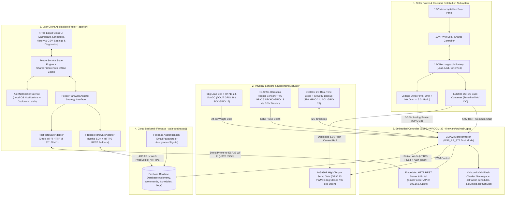

---

## Flowchart 2: Mobile Application Workflow

Traces the complete lifecycle of the Flutter application from startup (`app/lib/main.dart`) through onboarding, transport initialization, dashboard monitoring, manual feeding, schedule management, log export, diagnostics, and alert handling.

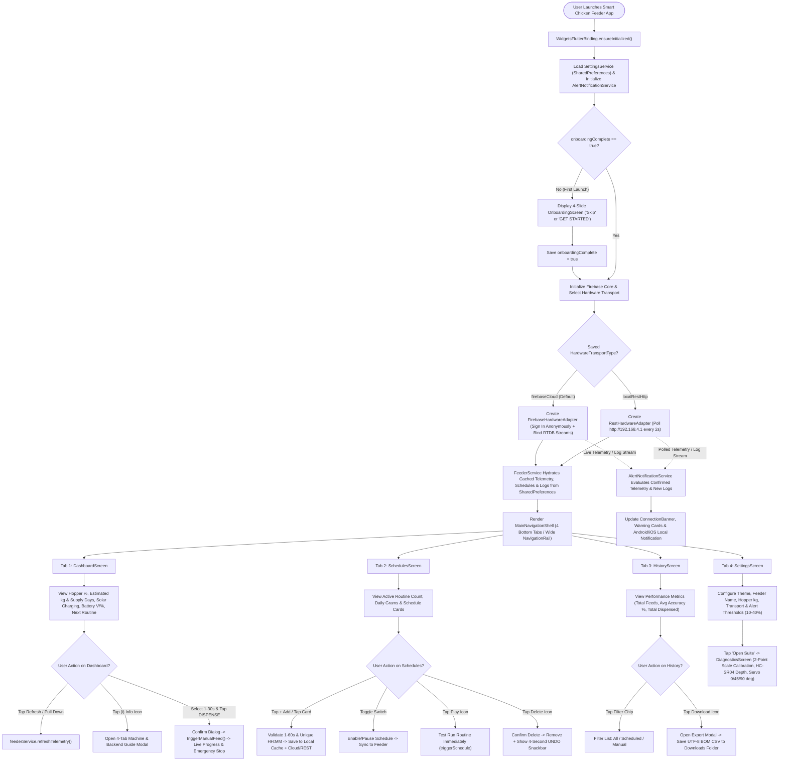

---

## Flowchart 3: ESP32 Firmware Boot & Main Loop Workflow

Reflects the exact non-blocking execution architecture implemented in `firmware/src/main.cpp` (`setup()` lines 1353–1454 and `loop()` lines 1456–1528).

```mermaid
flowchart TD
    BOOT(["ESP32 Power-On / Reset"]) --> SERIAL["Serial.begin(115200) & Status LED (GPIO 2) LOW"]
    SERIAL --> SAFE_GATE["SAFETY FIRST: Attach Servo (GPIO 13) & Close Gate Immediately to 0 deg"]
    SAFE_GATE --> LOAD_NVS["Open NVS Preferences ('feeder'): Load calFactor, lastCmdId, lastSchSlot & Saved Schedules"]
    LOAD_NVS --> INIT_SENS["Configure Ultrasonic Pins (TRIG 5, ECHO 18), Battery ADC (GPIO 34, 11dB) & HX711 (GPIO 16/17)"]

    INIT_SENS --> CHK_HX{"HX711 Ready Within 800ms?"}
    CHK_HX -- "Yes" --> TARE_BOOT["Apply calFactor & Run safeScaleTare(10)"]
    CHK_HX -- "No" --> WARN_HX["Set hx711Ready = false & lastSensorError = 'hx711_boot_timeout'"]

    TARE_BOOT --> INIT_RTC["Wire.begin(21, 22) & Probe DS3231 I2C Real-Time Clock"]
    WARN_HX --> INIT_RTC

    INIT_RTC --> WIFI_MODE["Set WiFi.mode(WIFI_AP_STA) & Start SoftAP 'SmartFeeder-AP' (192.168.4.1:80)"]
    WIFI_MODE --> HTTP_START["Register Local REST Endpoints (/api/*) & httpServer.begin()"]
    HTTP_START --> STA_TRY{"WIFI_SSID Configured & Connected Within 6s?"}

    STA_TRY -- "Yes" --> CLOUD_BOOT["Sync NTP Clock (UTC+8) -> Update DS3231 if Lost Power -> Obtain Firebase Auth Token"]
    CLOUD_BOOT --> PURGE_BOOT["purgeStaleCommandsOnBoot() (DELETE /commands/dispense & /stop) + syncSchedulesFromFirebase()"]
    PURGE_BOOT --> PUSH_INIT["pushTelemetryToFirebase() Initial Snapshot"]
    STA_TRY -- "No (Offline / Off-Grid)" --> WARN_WIFI["Log Offline Mode: SoftAP + DS3231 Autonomous Schedules Active"]

    PUSH_INIT --> LOOP_START(["Enter Non-Blocking loop() (10ms Yield Cycle)"])
    WARN_WIFI --> LOOP_START

    LOOP_START --> L_HTTP["1. httpServer.handleClient() & handleSerialCommands()"]
    L_HTTP --> L_SERVO_AUTO{"Servo Bench Test Active & > 10s Elapsed?"}
    L_SERVO_AUTO -- "Yes" --> CLOSE_BENCH["Auto-Close Servo Gate to 0 deg"] --> L_WIFI_TMR
    L_SERVO_AUTO -- "No" --> L_WIFI_TMR{"2. Every 15,000 ms: Check Station Wi-Fi"}

    L_WIFI_TMR -- "Disconnected" --> WIFI_REC["Non-Blocking WiFi.reconnect()"] --> L_CMD_TMR
    L_WIFI_TMR -- "Just Reconnected" --> WIFI_RESYNC["Sync NTP + purgeStaleCommandsOnBoot() + syncSchedulesFromFirebase()"] --> L_CMD_TMR
    L_WIFI_TMR -- "Unchanged" --> L_CMD_TMR{"3. Every 1,500 ms (If Wi-Fi Connected): Poll Commands"}

    L_CMD_TMR -- "Due" --> POLL_FB["pollFirebaseCommands() (/commands/dispense.json)"] --> L_TELEM_TMR
    L_CMD_TMR -- "Not Due" --> L_TELEM_TMR{"4. Every 10,000 ms: Telemetry Cycle"}

    L_TELEM_TMR -- "Due" --> PUSH_TELEM["Read Sensors -> Update Status -> Push /telemetry.json (If Wi-Fi Connected)"] --> L_SCH_SYNC
    L_TELEM_TMR -- "Not Due" --> L_SCH_SYNC{"5. Every 30,000 ms (If Wi-Fi Connected): Schedule Sync"}

    L_SCH_SYNC -- "Due" --> SYNC_SCH["syncSchedulesFromFirebase() (/schedules.json -> NVS)"] --> L_AUTO_SCH
    L_SCH_SYNC -- "Not Due" --> L_AUTO_SCH{"6. Every 5,000 ms: Autonomous Schedule Check"}

    L_AUTO_SCH -- "Due" --> CHK_RTC["checkAutonomousSchedules() via DS3231 / NTP"] --> LOOP_DELAY["delay(10)"]
    L_AUTO_SCH -- "Not Due" --> LOOP_DELAY
    LOOP_DELAY --> LOOP_START
```

---

## Flowchart 4: Firebase Communication & Command Lifecycle Workflow

Shows the exact authentication, command queuing, pre-actuation deletion, execution acknowledgement, telemetry streaming, and token refresh sequence between the Flutter App, Firebase Realtime Database, and ESP32.

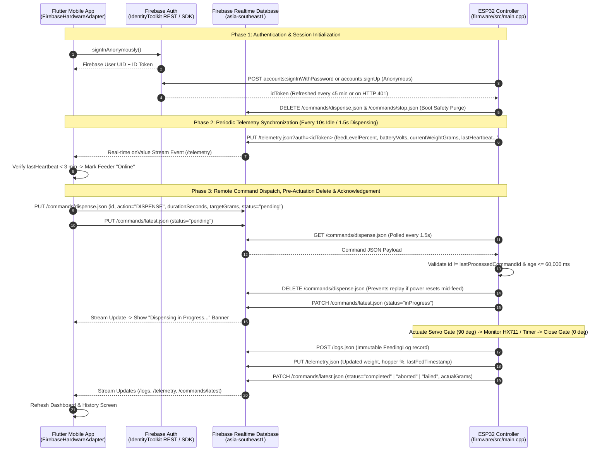

---

## Flowchart 5: Automated Feeding Workflow (Gravimetric & Timed Fallback)

Details the complete physical dispensing state machine in `firmware/src/main.cpp` (`dispenseFeed` lines 632–809 and `dispenseFeedDuration` lines 815–914), including all implemented hardware safety interlocks and failure branches.

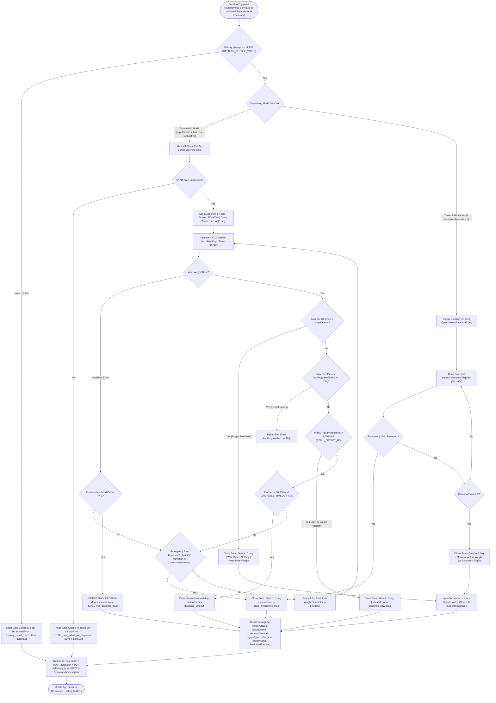

---

## Flowchart 6: Manual Feeding & Emergency Stop Workflow

Illustrates how an operator triggers an immediate feed or emergency stop from the mobile Dashboard (`app/lib/screens/dashboard_screen.dart` & `app/lib/services/feeder_service.dart`).

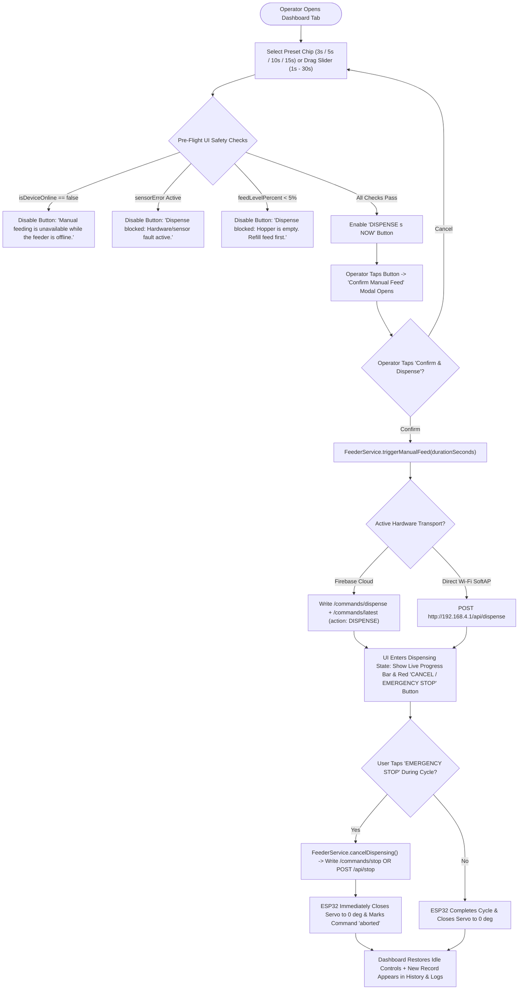

---

## Flowchart 7: Scheduled Feeding Workflow (Cloud Sync & Offline RTC)

Explains how schedules are created in the app, synchronized to Firebase or SoftAP, stored in ESP32 non-volatile flash (NVS), and executed autonomously via the DS3231 Real-Time Clock even without internet (`checkAutonomousSchedules()` in `firmware/src/main.cpp` lines 572–627).

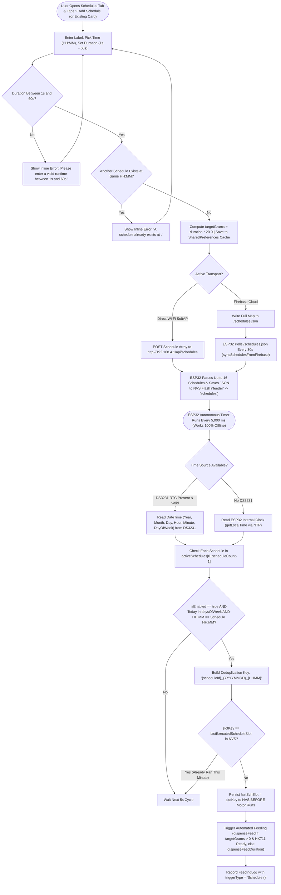

---

## Flowchart 8: Sensor Monitoring & Health Evaluation Workflow

Details how the ESP32 samples all three physical sensing subsystems and computes the prioritized system status (`firmware/src/main.cpp` lines 253–388).

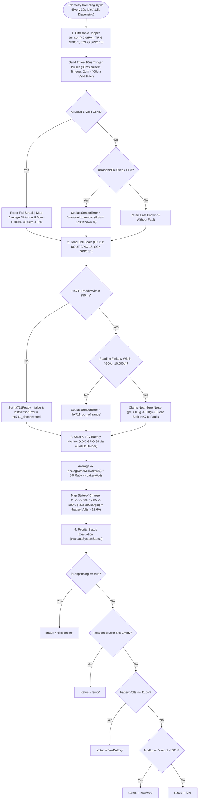

---

## Flowchart 9: Notification & Real-Time Alert Workflow

Shows how `AlertNotificationService` (`app/lib/services/alert_notification_service.dart`) evaluates live telemetry and feeding logs while preventing cold-start false alarms and notification spam.

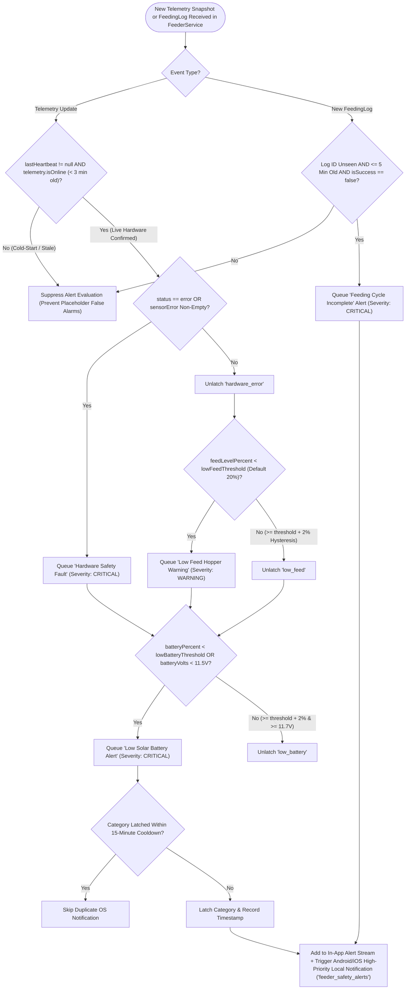

---

## Flowchart 10: Wi-Fi Connection, SoftAP & Reconnection Workflow

Demonstrates the actual `WIFI_AP_STA` dual-mode networking in `firmware/src/main.cpp` and transport switching in the mobile app.

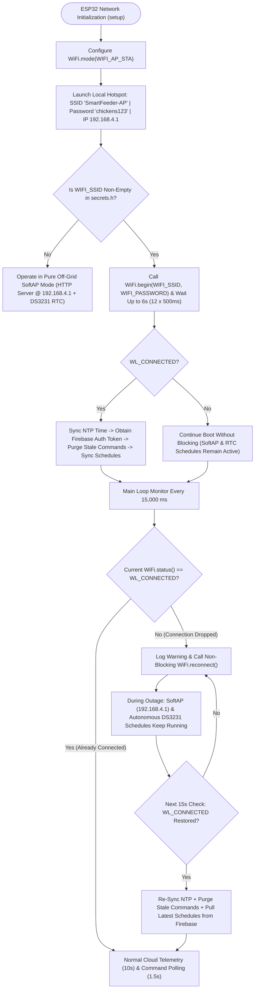

---

## Flowchart 11: Error Handling, Safety Interlocks & Recovery Workflow

Summarizes how the system detects, isolates, and recovers from network, power, sensor, mechanical, and command faults, distinguishing **IMPLEMENTED** behavior from **RECOMMENDED IMPROVEMENT** items.

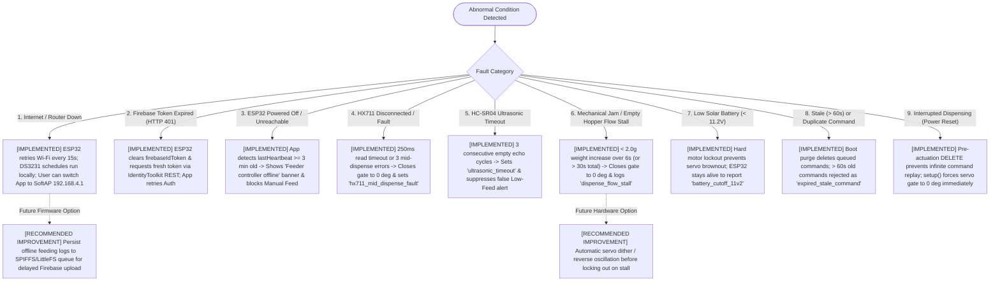
